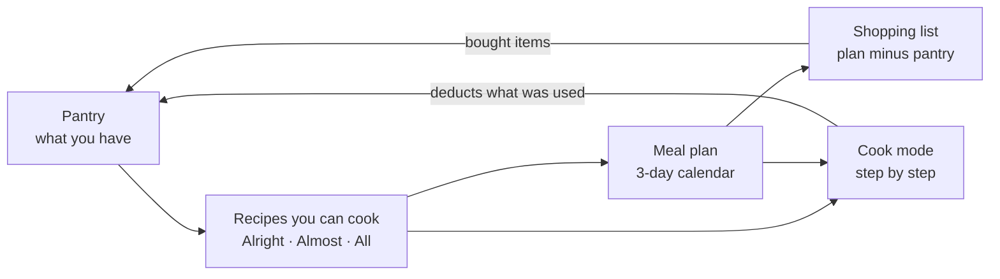
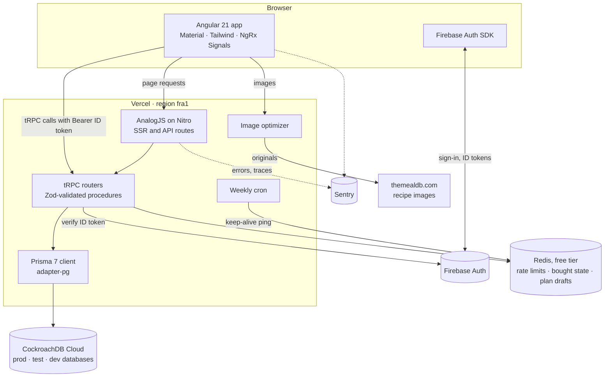
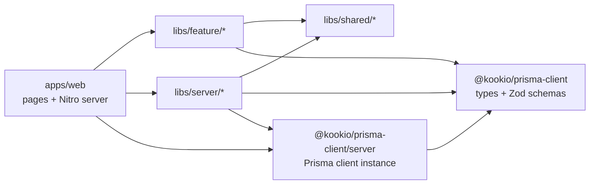
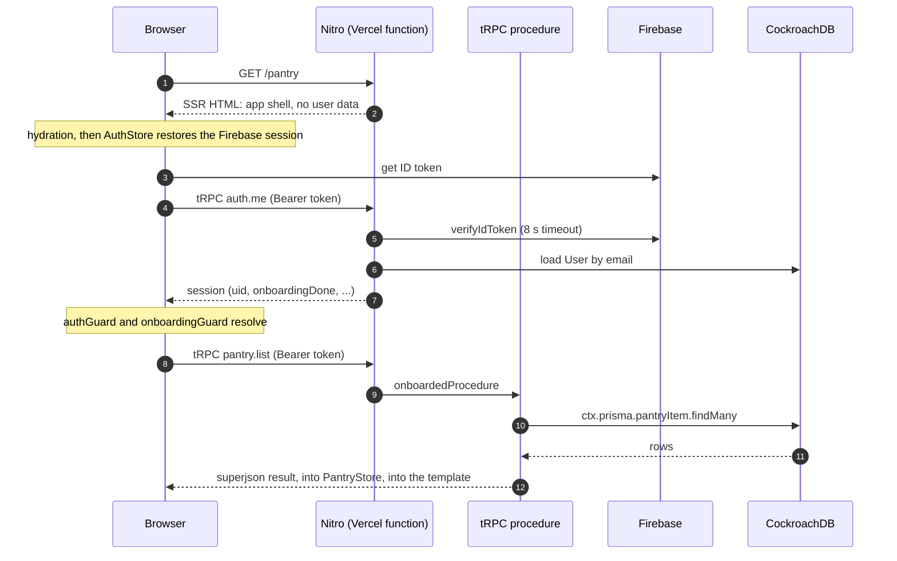
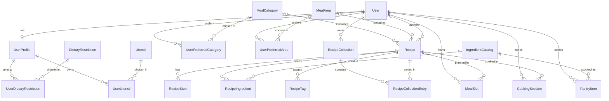

# Kookio — archive notes

> **Kookio was archived in October 2026.** Development stopped on 2 July 2026, once the
> project had served its purpose as the case study of a bachelor thesis. This file is the
> entry point for anyone coming back to it cold — most likely its author, years later. It
> records where the project came from, what it set out to solve, how every part of it
> worked, what was left unfinished, and what it takes to bring it back to life. How the
> product evolved — the plans, the decisions that shaped it and the ideas never built — is
> told in its companion, [`PRODUCT-HISTORY.md`](PRODUCT-HISTORY.md).
>
> Everything below was checked against the code, the git history and the live services on
> 9 October 2026, the day the project was archived: this repository was made read-only, and
> the Vercel project was deleted shortly after. Where other documents in this repository
> disagree with the code, trust the code; the known disagreements are listed in
> [section 9.4](#94-where-the-docs-disagree-with-the-code).

## At a glance

|                              |                                                                                                                                                                                                                                                                                            |
| ---------------------------- | ------------------------------------------------------------------------------------------------------------------------------------------------------------------------------------------------------------------------------------------------------------------------------------------ |
| **What it is**               | A pantry-first cooking companion. You record what is in your kitchen; Kookio shows which of ~600 recipes you can cook right now, lets you plan meals on a calendar, derives the shopping list from the plan minus the pantry, and walks you through cooking while deducting what you used. |
| **Why it was built**         | As the vehicle for the bachelor thesis _Arhitectura PAN (Prisma–Analog–Nx)_ (Computer Science, University of Bucharest, defended July 2026), set in a real domain: household food waste caused by buying without a plan.                                                                   |
| **Lifetime**                 | 14 Sep 2025 → 2 Jul 2026, archived 9 Oct 2026 · one author · about 400 commits · about 30 merged pull requests                                                                                                                                                                             |
| **Stack**                    | Angular 21 + AnalogJS 2.5 (SSR on Nitro) · tRPC 10 + Zod 4 · Prisma 7 → CockroachDB · Firebase Auth · Redis · Nx 22 monorepo · Vercel                                                                                                                                                      |
| **Final code**               | `main`, tagged `v1.0.0`; this repository is archived (read-only)                                                                                                                                                                                                                           |
| **Production**               | <https://kookio.app> (branch `main`), plus `test.kookio.app` and `dev.kookio.app` — Vercel project `kookio`, region `fra1`. **Deleted in October 2026**, after the archive; section 10.4 rebuilds it.                                                                                      |
| **Domain**                   | `kookio.app`, bought through Vercel Domains, paid until **2 December 2026**; renewal and auto-renew are managed in Vercel's Domains settings                                                                                                                                               |
| **Thesis and data pipeline** | Private repository [`EduardEmanuel/kookio-thesis`](https://github.com/EduardEmanuel/kookio-thesis): the LaTeX sources and the TheMealDB pipeline that produced this repository's seed data                                                                                                 |

## Contents

1. [Where it started](#1-where-it-started)
2. [The problem it set out to solve](#2-the-problem-it-set-out-to-solve)
3. [What the product does](#3-what-the-product-does)
4. [How it worked](#4-how-it-worked)
5. [Data model and data pipeline](#5-data-model-and-data-pipeline)
6. [The product's algorithms](#6-the-products-algorithms)
7. [Decisions, reversals and lessons](#7-decisions-reversals-and-lessons)
8. [Timeline](#8-timeline)
9. [State at archive time](#9-state-at-archive-time)
10. [Bringing it back to life](#10-bringing-it-back-to-life)
11. [Where everything lives](#11-where-everything-lives)

---

## 1. Where it started

Kookio began on 14 September 2025 as an empty Nx workspace holding an AnalogJS app
(Angular with server-side rendering) and a Playwright suite. Its first feature was a list of
ingredients served from mock data. The README written in October 2025 already carried the
pitch — _"helps home cooks curate ingredient inventories and discover recipes through
interactive, real-time exploration"_ — and the label that later became the thesis: the
**PAN stack**, for Prisma + Analog + Nx.

Autumn and winter 2025 built plumbing rather than product: Prisma with generated Zod schemas
around a single `Ingredient` table, a move from Postgres to CockroachDB (25 October), CI on
GitHub Actions, deployment to Vercel (the first successful production deployment was on
21 December), three environments with a database each, and the `apps/` + `libs/` layout.
February and March 2026 have no commits.

The product itself was written between **19 April and 20 June 2026** — about 340 of the
~400 commits. It opened with one large commit (`de7545b`, 19 April) that brought in the real
domain model: 19 Prisma models, Firebase authentication and a seed of ~595 recipes derived
from TheMealDB. The thesis was finalised on 16 June 2026 and defended in July; the last
development commit is from 2 July.

How the early ambitions turned out:

| Planned in 2025                                         | What actually happened                                                                                         |
| ------------------------------------------------------- | -------------------------------------------------------------------------------------------------------------- |
| CockroachDB, for horizontal scaling                     | Done (October 2025). The thesis later conceded that it is more database than an app of this size needs.        |
| Firebase with passwordless and social login             | Firebase with email and password only. A WebAuthn (passkey) track was scaffolded, never wired up, and removed. |
| Redis for sessions and recipe-search caching            | Redis holds rate limits, the groceries "bought" state and meal-plan drafts — never sessions or search.         |
| AI services suggesting recipes and pantry optimisations | Never built.                                                                                                   |

## 2. The problem it set out to solve

Two problems, deliberately kept apart.

### 2.1 The domain problem: food bought without a plan gets wasted

From the sources cited in the thesis introduction:

- Households wasted more than 631 million tonnes of food in 2022 — 60 % of all food waste
  (UNEP, _Food Waste Index Report 2024_).
- Each EU inhabitant generated 132 kg of food waste in 2022, 54 % of it at home (Eurostat).
- The European Parliament lists impulse buying, the lack of meal planning and poor
  management of the home food inventory among the main consumer-side causes.
- A review of 60 empirical studies (Schanes et al., 2018) found that planning
  purchases and checking the inventory before shopping are decisive practices; shopping
  with a list alone cut per-capita waste by about 20 %.

Kookio turns those practices into one loop:



The honest scope, stated in the thesis as well: an app like this can reduce redundant
purchases; it cannot solve food waste. Intentions do not automatically become behaviour,
and some causes are structural. No behavioural outcome was ever measured — food waste was
the _motivating domain_, not a validated result.

### 2.2 The engineering problem: keeping a full-stack app coherent

The thesis contribution was the **PAN architecture**: a full-stack model built entirely in
TypeScript, in which every layer shares types and validation schemas derived from one
source of truth.

- `schema.prisma` is the single data contract. `prisma-zod-generator` turns it into Zod
  schemas; derived types are composed from those with `.pick()`, `.omit()` and `.extend()`;
  tRPC validates procedure inputs with them; Angular consumes the inferred types. Rename a
  column and every consumer fails to compile.
- An Nx monorepo whose library graph is kept acyclic by `@nx/enforce-module-boundaries`,
  checked in CI.
- No repository layer: tRPC procedures call `ctx.prisma` directly.

In the thesis' own words, PAN does not reduce the number of tools; it puts them under one
language and formalises the boundaries between them. Kookio is where that claim was
implemented and measured. The thesis also states PAN's costs: the Angular and advanced
TypeScript learning curve, AnalogJS's small community, tRPC's TypeScript-only clients,
CockroachDB's overhead at small scale and moderate Vercel lock-in.

## 3. What the product does

### 3.1 The user journey

1. **Register or log in** with email and password (Firebase). Registration creates the
   database `User`, whose id is the Firebase uid, and sends the user to onboarding.
2. **Onboarding** is a six-step wizard: name → "fridge" (stage pantry items and pick
   favourite meal categories and cuisines) → utensils → household size (adults 1–20,
   children 0–20) → dietary restrictions → summary. Steps 1–4 can be skipped. A single
   transactional `onboarding.commit` writes everything, seeds the pantry and creates the
   user's "favorites" collection.
3. **Dashboard**: a greeting and four widgets — items expiring within 7 days, today's
   breakfast, lunch and dinner, groceries left to buy, and the top saved recipes.
4. **Pantry**: one row per ingredient, picked from a fixed catalog by autocomplete, with a
   quantity, a unit and an optional expiry date. Expired items are listed separately and
   every item carries an expiry badge.
5. **Recipes**: a public feed of 594 recipes. `/recipes/match` splits them into **Alright**
   (nothing missing — the default), **Almost** (one to three ingredients missing) and
   **All**. A recipe page shows category, cuisine, difficulty, servings, ingredients, steps
   and video or source links.
6. **Plan**: a three-day window centred on today (navigable, with a date picker) by
   breakfast, lunch and dinner. On desktop a sidebar of matching recipes can be dragged into
   cells; clicking an empty cell opens a recipe picker. "Save plan" replaces the stored plan,
   and unsaved edits survive reloads as drafts.
7. **Groceries**: never typed by hand. The list is every planned recipe's ingredients,
   scaled by servings, minus whatever is already in the pantry, grouped by supermarket
   aisle. Ticked items can be moved into the pantry in one go.
8. **Cook**: choose servings (1, 2, 3, 4, 6 or 8), start, walk the steps (`?step=N`
   deep-links to a step), finish. A dialog pre-fills the quantities used, scaled to the
   servings; confirming deducts them from the pantry.
9. **Saved**: bookmarks go into one implicit "favorites" collection, shown flat or grouped
   by cuisine or category.
10. **Account**: change the display name, restart onboarding (previous answers are kept),
    log out.

Also present: a light, dark and automatic theme; a PWA manifest; `/about`;
`/legal/attributions`; a 404 page and `/server-error`.

### 3.2 Routes

All pages live flat in `apps/web/src/app/pages/` (AnalogJS file-based routing; a dot in a
file name is part of the path, not nesting). "Gated" means `authGuard` + `onboardingGuard`.

| URL                             | File                                             | Access                               | Data                                                                      |
| ------------------------------- | ------------------------------------------------ | ------------------------------------ | ------------------------------------------------------------------------- |
| `/`                             | `(home).page.ts`                                 | public                               | `recipes.feed`, loaded in the browser                                     |
| `/recipes`                      | `recipes.page.ts`                                | public                               | the same feed; signed-in users without a profile get an onboarding prompt |
| `/recipes/match`                | `recipes.match.page.ts`                          | gated                                | `recipes.match`                                                           |
| `/recipes/saved`                | `recipes.saved.page.ts`                          | gated                                | `SavedStore`                                                              |
| `/recipes/:id`                  | `recipes.[id].page.ts` + `.server.ts`            | public                               | server loader (`recipes.byId`, rendered on the server)                    |
| `/cook/:recipeId`               | `cook.[recipeId].page.ts` + `.server.ts`         | gated                                | server loader for the recipe; the pantry is fetched in the browser        |
| `/dashboard`                    | `dashboard.page.ts`                              | gated                                | pantry, plan and saved stores; `groceries.stats`                          |
| `/pantry`                       | `pantry.page.ts`                                 | gated                                | `PantryStore`                                                             |
| `/plan`                         | `plan.page.ts`                                   | gated, plus an unsaved-changes guard | `PlanStore`, `recipes.match`                                              |
| `/groceries`                    | `groceries.page.ts`                              | gated                                | `GroceriesStore`                                                          |
| `/onboarding`                   | `onboarding.page.ts`                             | signed in                            | page-scoped `OnboardingStore`                                             |
| `/account`                      | `account.page.ts`                                | gated                                | `profile.updateName`, `onboarding.reset`                                  |
| `/login`, `/register`           | `login.page.ts`, `register.page.ts`              | guests only                          | Firebase via `AuthStore`                                                  |
| `/about`, `/legal/attributions` | `about.page.ts`, `legal.attributions.page.ts`    | public                               | static                                                                    |
| `/server-error`, `**`           | `server-error.page.ts`, `[...not-found].page.ts` | public                               | static                                                                    |

## 4. How it worked

### 4.1 The big picture



### 4.2 Repository layout and boundaries

```text
apps/
  web/            Angular + AnalogJS app: pages (file-based routes) and the Nitro server
  web-e2e/        Playwright suite, page objects, fixtures
libs/
  feature/        one library per domain — Signal Store(s), UI and a tRPC injection token:
                  auth · shell · dashboard · onboarding · pantry · recipes · plan · groceries · saved
  prisma-client/  schema.prisma, migrations, seed data, generated client and Zod schemas
  server/         server only: trpc (routers, context, procedure builders) · auth (Firebase Admin)
                  · logger (Pino, forwarding errors to Sentry)
  shared/         stateless: ui (kookio-icon, kookio-emoji, …) · utility (grams pipeline, labels,
                  URLs, icon manifest) · observability (browser Sentry) · mock (fixtures, seed users)
scripts/          seeds, asset builders (icons, Twemoji, PWA icons, DBML), env wrapper, benchmarks
tools/lint/       custom ESLint rules
.ai/              engineering guidelines, 25 chapters — see section 9.4 for the parts that drifted
```

There is deliberately no `data-access` or `types` library: stores live with their feature,
types with the code that owns them. Each `project.json` carries a `scope:*` tag, and
`@nx/enforce-module-boundaries` turns the rules into lint errors:

- server and Prisma code cannot import front-end code;
- front-end code cannot import server libraries;
- the Prisma client instance is reachable only through `@kookio/prisma-client/server`, which
  ESLint bans in front-end code. The root barrel `@kookio/prisma-client` exports only types
  and Zod schemas, so it is safe in the browser.



### 4.3 Life of a request

Every route is server-rendered; nothing is prerendered (that is what lets the Content
Security Policy nonce cover every page). Server rendering only ever includes **public**
data:

- The two detail pages, `/recipes/:id` and `/cook/:recipeId`, load their recipe on the
  server through `.server.ts` loaders that call the router in-process
  (`appRouter.createCaller(...)`).
- Every other page is rendered as a shell and loads its data in the browser after
  hydration. Checked on production on 9 October 2026: the home page's HTML contains none of
  the 594 recipe titles; a recipe page's HTML contains its title.
- The reason: AnalogJS page loaders run as plain fetches during client-side navigation and
  do not carry the Firebase Bearer token, so authenticated data cannot be loaded there
  (pattern 1 in the thesis). Gated pages render optimistically on the server — the guards
  return `true` during SSR — and the browser enforces them after hydration.



### 4.4 Authentication

- **Client.** The Firebase JavaScript SDK with email and password and local persistence.
  `AuthStore` (`libs/feature/auth/src/lib/auth.ts`) holds the Firebase user, the server
  session returned by `auth.me` (uid, email, name, `onboardingDone`), the ID token and
  readiness flags: `isReady = authReady && (!currentUser || sessionSettled)`. `ready$()`
  has an 8-second fallback, a 5-second safety timer covers a Firebase SDK that never
  answers, and tokens are refreshed every 55 minutes.
- **Transport.** Every tRPC call goes through `authAwareFetch` (`apps/web/src/trpc-client.ts`),
  which attaches `Authorization: Bearer <ID token>`, refreshes a token that expires within
  5 minutes, retries once on a 401, and rewrites relative URLs during SSR — a job it has to
  re-implement because `@analogjs/trpc` does not export its own fetch helper (see
  `.ai/11_trpc.md`).
- **Server.** `createContext` calls `resolveAuth` (`libs/server/auth`), which verifies the
  token with Firebase Admin (credentials from `FIREBASE_SERVICE_ACCOUNT_JSON_B64`), loads the
  `User` **by email** and builds the session. Nothing is cached.
- **Procedure builders.** `publicProcedure`, `protectedProcedure` (signed in) and
  `onboardedProcedure` (signed in and onboarded). The onboarding endpoints are deliberately
  only `protected`, because they run before onboarding is finished.
- **Guards.** `authGuard`, `onboardingGuard` and `guestGuard`; all of them let the server
  render and decide in the browser.

### 4.5 Client state and talking to the server

- One NgRx Signal Store per feature: `PantryStore`, `PlanStore`, `GroceriesStore` and
  `SavedStore` are root-scoped; `OnboardingStore` is page-scoped so one user's selections
  can never leak to the next. Classic NgRx is not used.
- Feature libraries never import the tRPC client. Each declares an injection token with a
  typed interface — `PANTRY_TRPC`, `RECIPES_TRPC`, `MEAL_PLAN_TRPC`, `GROCERIES_TRPC`,
  `SAVED_TRPC`, `COOKING_SESSION_TRPC`, `ONBOARDING_TRPC`, `AUTH_TRPC` — and
  `apps/web/src/app/app.config.ts` binds all of them to the single client
  (`useExisting: TrpcClientApp`). This keeps the libraries testable and the server code out
  of their bundles. Light tokens sit behind sub-path exports (for example
  `@kookio/feature-pantry/trpc`) because importing a feature barrel from `app.config.ts`
  pulls its heavy components into every route's server render.
- A trap worth remembering: those interfaces declare `Promise<T>`, but `@analogjs/trpc`
  returns Observables at runtime, so every call is wrapped in `from(...)`. A bare
  `await trpc.x.y.query()` is always a bug.
- Components that sit side by side share state through the root store (the plan calendar
  and the plan footer, for example), not through inputs and outputs.

### 4.6 The server

**tRPC** (`libs/server/trpc`, superjson transformer): 10 routers and 35 procedures, served at
`/api/trpc`.

| Router               | Procedures                                                                              | Access                               |
| -------------------- | --------------------------------------------------------------------------------------- | ------------------------------------ |
| `auth`               | `register`, `me`                                                                        | public (identity checked), signed in |
| `profile`            | `counts`, `updateName` (+ `completeOnboarding`, `resetOnboarding`, which nothing calls) | signed in                            |
| `onboarding`         | `commit`, `reset`, `current`                                                            | signed in                            |
| `onboardingCatalogs` | `dietaryRestrictions`, `utensils`, `mealCategories`, `mealAreas`                        | signed in                            |
| `pantry`             | `list`, `add`, `update`, `remove` · `searchIngredients`                                 | onboarded · signed in                |
| `recipes`            | `feed`, `byId` · `match`                                                                | public · onboarded                   |
| `recipeCollection`   | `getSaved`, `getSavedIds`, `toggleSave`                                                 | onboarded                            |
| `mealPlan`           | `getCurrent`, `setMealPlan`, `getDraft`, `setDraft`, `clearDraft`                       | onboarded                            |
| `groceries`          | `list`, `stats`, `toggleBought`, `addBoughtToPantry`                                    | onboarded                            |
| `cookingSession`     | `start`, `complete`                                                                     | onboarded                            |

**Nitro** (`apps/web/src/server/`):

| Path                                                                                             | Purpose                                                                                                                                                  |
| ------------------------------------------------------------------------------------------------ | -------------------------------------------------------------------------------------------------------------------------------------------------------- |
| `routes/api/trpc/[trpc].ts`                                                                      | tRPC handler. Rate-limits per IP first (300 requests a minute; 10 a minute for `auth.register`) — in production only, and failing open if Redis is down. |
| `routes/api/health.get.ts`                                                                       | Database and Redis round-trip check. Always answers HTTP 200; read the body.                                                                             |
| `routes/api/img.get.ts`                                                                          | Local stand-in for Vercel's image optimizer (sharp): resizes TheMealDB images to AVIF or WebP. Disabled on Vercel.                                       |
| `routes/api/cron/redis-keepalive.get.ts`                                                         | Pinged every Monday at 06:00 UTC by a Vercel cron so the free Redis instance is not deleted for inactivity.                                              |
| `routes/api/internal/bench-db.get.ts`                                                            | Latency benchmark behind `ALLOW_BENCH` and `BENCH_KEY`; used for the thesis measurements.                                                                |
| `middleware/security.ts`                                                                         | Returns an empty 404 for missing static assets (instead of the SSR page with status 200) and for bot probes such as `.php`, `wp-*` or `.env`.            |
| `plugins/csp.ts`                                                                                 | Mints a per-request nonce, stamps it on every inline `<script>` and sends the Content-Security-Policy header.                                            |
| `plugins/sentry.ts`                                                                              | Server-side Sentry (see 4.9).                                                                                                                            |
| `infra/redis.ts`, `infra/rate-limit.ts`, `infra/groceries-bought.ts`, `infra/meal-plan-draft.ts` | Redis client, fixed-window rate limiter and the two Redis-backed stores.                                                                                 |

The other security headers (HSTS, `X-Frame-Options`, `nosniff`, `Referrer-Policy`,
`Permissions-Policy`) and the long-lived cache headers come from `vercel.json`.

### 4.7 Persistence

- **Prisma 7** with the Rust-free `prisma-client` generator and the `@prisma/adapter-pg`
  driver adapter — CockroachDB speaks the Postgres wire protocol. Per function instance: a
  pool of at most 5 connections, a 20-second statement timeout and a 10-second connect
  timeout.
- `prisma.config.ts` reads `DATABASE_URL` with a placeholder fallback, so `generate`, builds
  and tests run offline; a guard extension makes a missing URL fail loudly at query time
  instead of producing unexplained connection errors.
- A retry extension retries every single-statement mutation up to three times on
  CockroachDB serialization conflicts (`P2034`, `P2036`, `40001`, "restart transaction").
  Four interactive `$transaction`s exist — `onboarding.commit`, `cookingSession.complete`,
  `groceries.addBoughtToPantry`, `mealPlan.setMealPlan` — and they are not retried as a
  whole.
- Migrations (10 of them) are applied by GitHub Actions, never by the Vercel build.
- **Redis** (node-redis 6) is optional. One free instance serves every environment, with
  keys prefixed `kookio:<VERCEL_ENV>`. The client connects lazily, stops trying for 60 s
  after a failure and gives up reconnecting after 12 attempts. Without Redis, rate limiting
  fails open, while the bought state and plan drafts fall back to `localStorage` in the
  browser and to per-instance memory on the server — the server answers
  `persisted: false` instead of an error.

### 4.8 UI system

- Angular Material 21 (Material 3) and the CDK for components; Tailwind 4 for layout.
- **Colours** come from a warm orange Material 3 palette written as CSS custom properties: 7
  files in `libs/shared/ui/src/styles/`, concatenated by `npx nx run ui:build-tokens` into
  `apps/web/src/styles/kookio-tokens.css` and loaded with a `<link>` tag, because a Sass
  importer bug in `nxViteTsPaths()` breaks SCSS in the global entry. Light, dark and
  higher-contrast variants are included, and `--mat-sys-*` variables carry the palette into
  Material. `apps/web/src/styles/kookio-material.css` holds hand-written Material overrides;
  it is a source file, not generated output.
- **Fonts** are self-hosted (Fredoka, Inter, Roboto), because the strict CSP blocks Google
  Fonts.
- **Icons**: a subsetted Material Symbols variable font and `<kookio-icon name="…">`, whose
  `name` is typed against a generated manifest. Run `npm run build:icons` after adding an
  icon; CI fails on drift.
- **Emoji**: self-hosted Twemoji SVGs and `<kookio-emoji char="…">`. Run
  `npm run build:twemoji` after adding one. The CC BY 4.0 attribution is at
  `/legal/attributions`. Category emoji and area flags are database columns filled by the
  seed.
- **Theme**: automatic, light or dark, stored in `localStorage` and applied before the first
  paint by an inline script — one of the reasons the CSP needs a nonce.
- Custom ESLint rules in `tools/lint/` ban legacy Material button selectors and unknown icon
  or emoji names.

### 4.9 Observability

- **Server**: Pino through `@kookio/server-logger`; `log.error({ err })` and `log.fatal` also
  forward the error to Sentry. A Nitro plugin initialises Sentry when `SENTRY_DSN` is set,
  reports 5xx responses, samples 10 % of traces, and drops events from non-production
  environments as well as Prisma connection errors (`P1001`, `P1017`).
- **Browser**: Sentry's Angular error handler and `reportError` from
  `@kookio/shared-observability`, filtering out Firebase sign-in errors, expected 401s and
  network blips.

### 4.10 Delivery: environments, CI and deploys

| Branch | URL               | Vercel     | Database      | GitHub environment |
| ------ | ----------------- | ---------- | ------------- | ------------------ |
| `main` | `kookio.app`      | production | `kookio_prod` | Production         |
| `test` | `test.kookio.app` | preview    | `kookio_test` | Testing            |
| `dev`  | `dev.kookio.app`  | preview    | `kookio_dev`  | Development        |

- **Vercel**'s Git integration builds every push: `main` goes to production, every other
  branch to a preview. The build runs `NODE_OPTIONS=--max-old-space-size=6144 nx build web` —
  the Nitro bundling step needs the large heap.
- **GitHub Actions** (`.github/workflows/pipeline.yml`) runs on pushes to `main`, `test` and
  `dev` and on pull requests to `main`:
  1. `ci` — icon-manifest check, format check, `nx affected -t lint test build`, and an Nx
     Cloud self-healing step;
  2. `coverage` — at least 80 % line coverage across the libraries (pull requests and
     `main`);
  3. `migrate-dev`, `migrate-test`, `migrate-prod` — `prisma migrate deploy` with retries,
     **followed by the seed** whenever the `SEED_ADMIN_*` secrets exist (see section 9.3);
  4. smoke tests that poll `/api/health` — in practice they skip (section 9.3);
  5. `e2e-test` on the `test` branch — Playwright in the official container;
  6. Discord and email alerts on failure.
- **Local hooks** (husky): pre-commit formats and lints the changed files; pre-push runs
  `nx affected -t lint test`, plus a build when pushing `main`.
- Migrations and deploys are separate systems that race each other: a schema change can go
  live before its migration, or the other way round.

## 5. Data model and data pipeline

### 5.1 Schema

`libs/prisma-client/schema.prisma`: 20 models, 5 enums and 10 migrations
(18 April → 28 May 2026; the `init` migration re-based all earlier history). Primary keys are
UUIDs, and composite unique constraints carry business rules.



| Area        | Models                                                                                         | Notes                                                                                                                                                                |
| ----------- | ---------------------------------------------------------------------------------------------- | -------------------------------------------------------------------------------------------------------------------------------------------------------------------- |
| Identity    | `User`, `UserProfile`                                                                          | The profile (1:1) holds household size and `onboardingDone`. `User.isDisabled` and `deletedAt` exist but nothing reads them.                                         |
| Preferences | `DietaryRestriction`, `Utensil`, their junctions; `UserPreferredCategory`, `UserPreferredArea` | Restriction and utensil choices hang off the profile; category and cuisine preferences hang off the user.                                                            |
| Catalog     | `IngredientCatalog`, `MealCategory`, `MealArea`                                                | From TheMealDB. `IngredientCatalog.normalizedName` is the join key used when seeding; `pieceGrams` feeds the grams pipeline.                                         |
| Recipes     | `Recipe`, `RecipeStep`, `RecipeIngredient`, `RecipeTag`                                        | Each ingredient appears at most once per recipe (`@@unique([recipeId, ingredientCatalogId])`). Status `PUBLIC` or `PRIVATE`; user-authored recipes were never built. |
| Pantry      | `PantryItem`                                                                                   | `@@unique([userId, ingredientCatalogId])`: one row per ingredient, with quantity, unit and optional expiry.                                                          |
| Planning    | `MealSlot`                                                                                     | `@@unique([userId, date, slotType])`. There is no "plan" entity; an empty cell simply has no row.                                                                    |
| Cooking     | `CookingSession`                                                                               | `completedAt` is null while cooking is in progress. Deleting a recipe deletes its sessions.                                                                          |
| Collections | `RecipeCollection`, `RecipeCollectionEntry`                                                    | The schema allows named collections; the app only uses one, `favorites`.                                                                                             |

Enums: `RecipeStatus`, `MealSlotType` (`SNACK` exists but cannot be edited in the UI),
`MeasureUnit` (18 units), `IngredientCategory` (13 categories) and `Difficulty`.

An interactive diagram is published at
[dbdocs.io/dinea.eduard/kookio-db](https://dbdocs.io/dinea.eduard/kookio-db?schema=public&view=relationships)
(password-protected; the password is not stored in this repository). Its source is
`libs/prisma-client/dbml/kookio.dbml`, regenerated with `npm run gen:dbml`.

### 5.2 Where the recipe data came from

Nothing in the catalog was typed by hand. An offline pipeline of TypeScript scripts — kept in
the **thesis repository** under `research/the-meal-db/`, not here — pulls TheMealDB's premium
API (it needs `THEMEALDB_API_KEY`) and cleans the crowd-sourced data in phases:

1. fetch the catalog (categories, cuisines, ingredients) and generate plural/singular merge
   candidates;
2. clean the catalog: normalise names to a stable `snake_case` key and assign each ingredient
   a category with twelve ordered rules;
3. fetch every recipe by scanning the alphabet, parsing free-text measures such as
   "2 tbsp heaped" into quantity, unit and notes;
4. clean and enrich the recipes: split instructions into steps, estimate servings and
   difficulty (section 6.6);
5. apply hand-written step splits, then 24 idempotent residual fixes (Unicode fractions,
   plural ingredient names, tag typos, step restructuring).

The canonical `recipes.json` is **hand-refined**: the scripts write to a separate snapshot
and promotion is manual, so re-running the pipeline never overwrites the refinements. The
thesis repository's README documents every phase.

What this repository holds (`libs/prisma-client/seed-data/`):

| File                    | Content                                                                                                                                         |
| ----------------------- | ----------------------------------------------------------------------------------------------------------------------------------------------- |
| `recipes.json`          | 594 recipes, 6,066 ingredient lines, 2,998 steps; difficulty split 179 easy / 238 medium / 177 hard. Identical to the thesis repository's copy. |
| `catalog.json`          | 14 categories with emoji, 37 cuisines with flags and 872 ingredients, 32 of them with `pieceGrams` (see 5.3)                                    |
| `merge-candidates.json` | 182 approved plural → singular aliases used to map recipe ingredients onto the catalog                                                          |

Dietary restrictions (10) and utensils (12) come from `libs/shared/mock/src/fixtures/`, and
recipe images are hot-linked from `www.themealdb.com`.

### 5.3 Seeding

`npm run seed:prisma-client` (`scripts/seeds/seed.ts`) runs, in order: an admin user through
Firebase Admin (only if `SEED_ADMIN_EMAIL` and `SEED_ADMIN_PASSWORD` are set), the catalog,
the recipes, dietary restrictions and utensils, four mock users written directly to the
database, their profiles, and debug data for `usr_dev_user` (collections, pantry items,
cooking sessions and meal slots in the current week). Every write is an upsert; nothing is
ever deleted.

> **The seed data was incomplete for five and a half months.** On 21 April 2026 (`864b24b`)
> the seed was trimmed to 54 recipes and 215 ingredients to speed up CI. On 22 May
> (`3532709`) all 594 recipes came back, but the catalog did not. Recipe ingredients that do
> not resolve to a catalog row are **skipped with only a log line**, so seeding an empty
> database kept 4,429 of the 6,066 ingredient lines (73 %), and only 87 of the 594 recipes
> stayed complete. Production had been seeded before the trim and was complete — upserts
> never delete; verified on 9 October 2026. The archive commit `868e770` merged the 872
> ingredients back while keeping the `pieceGrams` values and category emoji added here since;
> every ingredient line now resolves. If you ever regenerate `catalog.json` from the
> pipeline, re-apply those additions: the thesis repository's copy does not have them.

## 6. The product's algorithms

### 6.1 Recipe matching (`recipes.match`)

`libs/server/trpc/src/lib/routers/recipes/` — a set difference on ingredient identity.

- The pantry becomes a map keyed by `ingredientCatalogId`. For each `PUBLIC` recipe, every
  ingredient line counts as present if its catalog id is in that map. **Only presence is
  checked; quantities and units are ignored**, deliberately: an occasional false positive is
  cheaper than duplicating unit logic at the matching boundary.
- Lines in negligible units (`TO_TASTE`, `TO_SERVE`, `GARNISH`, `PINCH`) are skipped, so salt,
  pepper or a garnish never block a recipe.
- Levels: **Alright** = 0 missing, **Almost** = 1–3 missing, **All** = no filter. Each result
  carries `missingCount`, `totalIngredients` and up to three `missingNames`.
- _All_ is a single cursor-paginated query. _Alright_ and _Almost_ scan the recipes in batches
  of 50 until the page is full, the data runs out or 1,500 recipes have been examined; the
  page then reports `partialScan`. With 594 recipes the budget never triggers.
- The procedure also accepts `categoryIds` and `areaIds` (preference filtering), but no client
  sends them.

### 6.2 The grams pipeline: one heuristic, two consumers

`libs/shared/utility/src/lib/labeling/measure-unit-labels.ts`, a pair of pure functions:
`toGrams` and `fromGrams`. Every quantity is normalised to grams before any arithmetic and
converted back to the display unit only at the end.

| Unit class   | Units                                         | Conversion                                                                                   |
| ------------ | --------------------------------------------- | -------------------------------------------------------------------------------------------- |
| Mass         | G, KG, OZ, LB                                 | fixed factors                                                                                |
| Volume       | ML, L, TSP (5 ml), TBSP (15 ml), CUP (240 ml) | water density: 1 ml = 1 g                                                                    |
| Pieces       | PIECE, SLICE, CLOVE, BUNCH, OTHER             | `amount × IngredientCatalog.pieceGrams`; 100 g when unknown and `allowDefault` is set        |
| Pinch        | PINCH                                         | 0.5 g                                                                                        |
| Flavour only | TO_TASTE, TO_SERVE, GARNISH                   | 0 g — a deliberate convention: "to taste" is the cook's call, and tracking it would be noise |

The same functions back the cook dialog, the pantry deduction and the merge of bought
groceries into the pantry. The offline data pipeline once had its own copy of this logic;
unifying the two (`d1c55cf`) is the third pattern described in the thesis. The cost of the
0 g convention: salt and oil running out over many small uses is never detected (section 9.2).

### 6.3 Cooking and the pantry deduction

`cookingSession.start` creates a session row (`completedAt` null). On finish, the dialog
proposes each ingredient scaled by `chosen servings / recipe servings`; the user can edit or
untick lines. `cookingSession.complete` then runs one transaction: for each confirmed line,
`pantry grams − used grams` is clamped at zero, the row is deleted below 0.5 g (the noise
threshold of a pinch) or updated in its own unit otherwise, and `completedAt` is set.
Lines without a pantry row, or that convert to 0 g, are skipped.

### 6.4 Groceries

`libs/server/trpc/src/lib/routers/groceries.*` — derived on every read, never stored:

1. Take **all** of the user's meal slots that hold a recipe (no date window).
2. Expand each into its recipe's ingredients, scaled by `slot servings / recipe servings`.
3. Drop flavour-only lines (`PINCH` stays) and every ingredient already present in the
   pantry, regardless of quantity.
4. Aggregate per ingredient and group by aisle.

The "bought" ticks live in Redis (`kookio:<env>:groceries:bought:<uid>`, 7-day TTL) and are
mirrored in `localStorage`. `toggleBought` takes the client's intended state, so when Redis is
down the server confirms it with `persisted: false` instead of failing, and the client keeps a
device-local copy. `addBoughtToPantry` re-derives the list inside a transaction and merges
the ticked items into existing pantry rows through the grams pipeline.

### 6.5 Planning and drafts

`MealSlot` rows are the whole plan. `mealPlan.setMealPlan` validates the slots, then deletes
all of the user's slots and recreates them in one transaction. Every edit is also saved as a
draft, both in `localStorage` and in Redis; on load the freshest of local draft, remote draft
and saved plan wins, and a successful save clears the drafts. The planner saves every slot
with 2 servings — there is no servings control.

### 6.6 Data-enrichment heuristics (offline)

- **Servings**: the bulk mass of a recipe (flavour-only ingredients excluded) divided by
  400 g, clamped to 1–12, with 2 as the fallback when fewer than two bulk ingredients or less
  than 200 g of usable data exist. 400 g is a typical main-course serving, chosen
  pragmatically — not a nutritional claim.
- **Difficulty**: score = ingredients + 2 × steps, compared with the catalog median (19):
  below 0.8335 × median is _easy_, above 1.1665 × median is _hard_, otherwise _medium_.

## 7. Decisions, reversals and lessons

The decisions below are the ones that matter when working on the code.
[`PRODUCT-HISTORY.md`](PRODUCT-HISTORY.md) has the full register — more than a hundred
decisions, with dates and what became of each — and the plans they came from.

### 7.1 Decision log

| Decision                                   | What and why                                                                                                                                                                                                                                       | Reference                                                     |
| ------------------------------------------ | -------------------------------------------------------------------------------------------------------------------------------------------------------------------------------------------------------------------------------------------------- | ------------------------------------------------------------- |
| No repository layer                        | Tried twice — in October 2025, and as a 38-file layer with a generator in April 2026 — and deleted the next day. Prisma is already a typed data layer and tRPC the business layer.                                                                 | `723c5b8`, `de7545b` → `408940a` (20 Apr 2026)                |
| CockroachDB                                | Chosen for horizontal scaling. Costs: serialization retries and a migration quirk (a spurious `DROP TYPE crdb_internal_region`, caught by `scripts/migration-guard.ts`). The thesis concedes plain Postgres would have been simpler at this scale. | `4bd9654` (25 Oct 2025)                                       |
| Scope-first library taxonomy               | Four groups (`feature`, `prisma-client`, `server`, `shared`) instead of Nx's `ui` / `data-access` / `util` split; the `core/*` group was later dissolved.                                                                                          | April 2026; PR #17                                            |
| Browser-safe barrel and `/server` sub-path | A runtime Zod import dragged the Prisma client into the browser and crashed hydration, and a barrel import pushed the `/login` cold start from ~6 s to ~58 s. The fix was made structural with an ESLint ban.                                      | `e77c921`, `b6c96b6`, `3af8749` (4 May 2026)                  |
| Self-hosted icons and emoji                | 2,122 bundled SVGs replaced by a subsetted Material Symbols font with no Google CDN; Twemoji, licensed CC BY 4.0 rather than share-alike, for consistent flags on Windows.                                                                         | `147ddd1`, `897bcd3`, `ff4f37a`                               |
| Remove what nothing uses                   | WebAuthn (stubs that were never mounted), roles and `/admin` (a stub page), the `MealPlan` aggregate, the feature-flag system and `core/*` libraries (never read), the quick-actions widget, the floating Cook-now button.                         | `89e46da`, `9915d75`, `07675ea`, PR #17, `a8837a9`, `dfa3b91` |
| One grams heuristic for two consumers      | The offline pipeline and the runtime share `toGrams`/`fromGrams` and `IngredientCatalog.pieceGrams` instead of two drifting copies.                                                                                                                | `d1c55cf` (28 May 2026)                                       |
| Presence-based matching                    | Present-or-missing per ingredient, no quantities. Levels renamed from A/B/C to the words the UI uses.                                                                                                                                              | `43f0fd4`, `2bb8638`                                          |
| Redis only for state that may degrade      | Bought ticks and plan drafts (both mirrored in `localStorage`) and rate limits; never sessions. A weekly keep-alive cron was added after the first free instance was deleted for inactivity.                                                       | `af765d7`, `2457e66`, `d495101`                               |
| Public data only in server rendering       | Page loaders do not carry the Bearer token on client navigation, so authenticated data hydrates in the browser, and guards render optimistically on the server.                                                                                    | thesis pattern 1; `93c8c98`                                   |
| Strict CSP with a per-request nonce        | The strict CSP blocked Google Fonts (they were self-hosted) and the inline scripts (theme, service worker, Angular event replay). A Nitro plugin stamps a nonce, and prerendering was dropped so every page passes through it.                     | `f15514a`, `2848611`, `36bc78b` (14–16 Jun 2026)              |
| Modernisation to Angular 21 and Prisma 7   | Prisma's driver adapter and `prisma.config.ts`, Zod 4, zoneless change detection. Gated majors were pinned (section 10.5).                                                                                                                         | `815fff9` (30 May 2026), `8f3d1d8`                            |
| No bundle surgery                          | `manualChunks` and `ssr.external` produced "Class extends value undefined" blank pages; the Nitro out-of-memory error was fixed with a 6 GB heap instead.                                                                                          | `93e8d0e`, `c6d1279`, `96edba2`                               |
| Semantic route names                       | `/server-error`, not `/500`: AnalogJS silently ignores page files whose names are all digits.                                                                                                                                                      | thesis pattern 2                                              |

### 7.2 Lessons

- **Build for needs you have observed.** Five systems were built ahead of a consumer and
  later deleted (WebAuthn, roles, feature flags, the `MealPlan` aggregate, quick actions). The
  typed stack made it easy to prove they were dead: no consumer of a type, safe to delete.
- **An import's cost is not local.** With server rendering, whatever `app.config.ts` and
  library barrels pull in is paid on every route (`.ai/08_e2e.md`).
- **A green pipeline is not a working app.** The CSP broke inline scripts in production
  without failing a single test, and the incomplete seed catalog (5.3) passes every check.
- **Free tiers have teeth.** The first Redis instance was deleted for inactivity, and in June
  2026 the Actions minutes ran out, so six pull requests were merged without CI.
- **Keep data and its provenance together.** The pipeline lives in another repository, and
  the trimmed catalog went unnoticed for five and a half months, until the archive review.
- **When a metric does not move, you are pulling the wrong lever** (`.ai/25_debugging.md`).

## 8. Timeline

| When                | Phase                       | Highlights                                                                                                                                                                                                                         |
| ------------------- | --------------------------- | ---------------------------------------------------------------------------------------------------------------------------------------------------------------------------------------------------------------------------------- |
| Sep–Oct 2025        | Bootstrap                   | Nx + AnalogJS + Playwright; Prisma with Zod; Apache-2.0 licence and the "PAN stack" name (`c3a4886`); move to CockroachDB (`4bd9654`)                                                                                              |
| Nov 2025 – Jan 2026 | Plumbing                    | Vercel build output (`eea5821`, 14 Dec); dev/test/prod pipelines and the first successful production deployment (`dfa256d`, 21 Dec); modular workflows (`a7338b6`); Redis; feature flags (`5bfc566`)                               |
| Feb–Mar 2026        | Pause                       | No commits                                                                                                                                                                                                                         |
| 19–27 Apr 2026      | Domain model and shell      | Schema, Firebase auth and seed (`de7545b`); repositories removed (`408940a`); responsive shell; the build-memory saga                                                                                                              |
| 26 Apr – 9 May      | Design system, onboarding   | Material Symbols font, Twemoji, Material 3 tokens, template lint rules; the six-step onboarding                                                                                                                                    |
| 2–7 May             | Recipes, pantry, cooking    | Feed and recipe pages, pantry, the `/server` split (`3af8749`), `recipes.match` (`43f0fd4`), cooking sessions (`bba21ab`), dashboard                                                                                               |
| 8–15 May            | Plan, groceries, saved      | WebAuthn and roles dropped; `MealPlan` flattened into `MealSlot`; derived groceries with Redis; saved recipes                                                                                                                      |
| 22–28 May           | Depth and PWA               | Steps and difficulty, 594 recipes back (`3532709`); `?step=` deep links (`de40125`); PWA; the grams pipeline (`d1c55cf`)                                                                                                           |
| 30 May – 4 Jun      | Modernisation               | Angular 21, Nx 22, AnalogJS 2, Vitest 4, Prisma 7, Zod 4, zoneless change detection (`815fff9`)                                                                                                                                    |
| 7–13 Jun            | Performance and measurement | Preference filters, image optimisation, Playwright page objects, reproducible benchmarks (`9da01f8`)                                                                                                                               |
| 12–20 Jun           | Hardening                   | Dead code removed (#17), Sentry, rate limiting and security headers, resilience, the reload fix (#27), 80 % coverage floor (#28), dbdocs, self-hosted fonts, CSP nonce (#31), Nx Cloud, CI cost cuts. Thesis finalised on 16 June. |
| 17 Jun – 2 Jul      | Coda                        | Three commits on `dev` only; pull request #38                                                                                                                                                                                      |
| 9 Oct 2026          | Archive                     | These notes and the product history; the full ingredient catalog restored; the `dev`-only commits and #38 merged; `v1.0.0` tagged; repository archived; Vercel project deleted shortly after                                       |

The busiest month was May 2026 (179 commits); the busiest day, 9 May 2026 (22 commits).

## 9. State at archive time

### 9.1 Finished, and how it was left

Every flow in section 3 works. Tests: 96 unit-spec files (about 870 cases, Vitest) and 8
Playwright specs (16 tests). CI enforces at least 80 % line coverage across the libraries.

How everything was left on 9 October 2026:

- `main` holds all finished work — including the three commits that had only been on `dev`
  — and is tagged `v1.0.0`. The GitHub repository is archived (read-only); unarchive it in
  its settings before pushing again.
- The Vercel project was deleted shortly after the archive, to free the account for other
  work. Its deployments, its environment variables and the weekly Redis keep-alive cron went
  with it; section 10.3 lists every variable it held and where each value comes from.
- The CockroachDB databases, the Firebase project and Sentry were left in place, untouched.
- `kookio.app` stays registered until 2 December 2026.

### 9.2 Unfinished work

| Item                         | State and way forward                                                                                                                                                                                                                                                                                                 |
| ---------------------------- | --------------------------------------------------------------------------------------------------------------------------------------------------------------------------------------------------------------------------------------------------------------------------------------------------------------------- |
| Resuming a cooking session   | A reload mid-cook returns to the setup phase, and starting again creates a second session row that is never completed. Plan: a `cookingSession.active` query, an idempotent `start` that reuses the open session, and a client-side restore that seeds the step from `?step=`. No migration needed; about half a day. |
| Tracking staples             | Flavour-only units count as 0 g, so salt or oil running out is never noticed. Plan: a user-set stock state per item (in stock, running low, out) that feeds the shopping list — never invented grams. No low-stock code exists, although the thesis describes a "running low" mark as already present.                |
| Dietary restrictions         | Collected at onboarding, never used: there is no `Recipe` ↔ `DietaryRestriction` relation. Plan: derive restriction tags from each recipe's ingredients offline, then add one more optional filter beside the category and cuisine ones.                                                                              |
| Preference filters           | `recipes.match` accepts `categoryIds` and `areaIds`, but no screen sends them.                                                                                                                                                                                                                                        |
| Ingredient variants          | Matching uses exact catalog identity, and the catalog holds both generic and specific variants (`flour`, `plain_flour`, `all_purpose_flour`, …), so stocking one does not satisfy a recipe that asks for another. It needs synonym groups or alias normalisation.                                                     |
| Quantity-aware matching      | Sketched in the thesis: normalise both sides to grams and require the pantry to cover the recipe.                                                                                                                                                                                                                     |
| Planner gaps                 | No servings control (every slot is saved with 2 servings), and the shopping list counts past slots as well as future ones.                                                                                                                                                                                            |
| Collections and user recipes | The schema supports named collections and `PRIVATE` user-authored recipes; neither has an interface.                                                                                                                                                                                                                  |
| `authReady` timeout          | The 5-second safety timer in `AuthStore` was never validated against real sign-in latency. The telemetry meant to settle it (`c5e114d`) reached `main` only at archive time, so no data was ever collected.                                                                                                           |
| PWA                          | `sw.js` is an inert stub with no caching, and `InstallPromptComponent` is never mounted: it is referenced only by `App`, while `main.ts` bootstraps `AppComponent`.                                                                                                                                                   |
| Never started                | Internationalisation, a Markdown content section, Open Graph images, real-time updates, a mobile wrapper (Ionic or Capacitor) and AI suggestions — the matching `.ai/` chapters are design notes only. The Angular template accessibility lint preset was never enabled.                                              |

### 9.3 Known defects and sharp edges

Verified on 9 October 2026:

- **Every successful push to `main` re-runs the seed against production.** The
  `migrate-prod` job seeds whenever the `SEED_ADMIN_*` secrets are set, and they are, in the
  Production environment. `seed.ts` has no production guard, so each run upserts the mock
  users and `usr_dev_user`'s debug data into production and resets the seeded admin's
  Firebase password to the secret's value. Each seed run takes about half an hour (33–34
  minutes in October 2026), because every row is a separate upsert, and the same seed runs
  against the test database for every pull request.
- **No GitHub environment has protection rules**, although `RUNBOOK.md` says production
  migrations need manual approval.
- **The CI end-to-end job does not test the preview deployment.** The composite action
  exports `PLAYWRIGHT_BASE_URL`, but the Playwright config reads `BASE_URL`, so the suite
  falls back to a local dev server inside the container. It last ran on 16 June: the push
  to `test` on 17 June was blocked by billing (see below), and since 17 June the job runs
  only on pushes to `test`, which has not moved since.
- **The smoke tests skip instead of testing.** `smoke-prod` reads `vars.VERCEL_APP_URL`,
  which is defined only on the three GitHub environments, and the job declares no
  `environment:`, so it logs "No BASE_URL, skipping." and still posts "Production deployed
  successfully" to Discord. On 9 October the preview smoke test skipped too, because no
  ready preview deployment was found. How long this has been so is unknown: run logs expire
  after 90 days. Even when the smoke tests run, `/api/health` returns HTTP 200 with the
  database down.
- **CI was blocked by billing from 17 to 20 June 2026.** Those red runs never executed a
  step ("recent account payments have failed or your spending limit needs to be
  increased"), so six pull requests, #32 to #37 (#34 into `dev`, the rest into `main`),
  were merged without CI. GitHub Actions minutes for private repositories are limited; the
  next run, on 2 July, passed.
- **List pages are server-rendered without their data**; feeds load after hydration.
- **Rate limiting fails open** and runs in production only.
- **Sentry drops Prisma connection errors (`P1001`, `P1017`) in production too**, a deliberate
  trade-off: a database outage will not page you.

### 9.4 Where the docs disagree with the code

| Document                                 | What it says                                                                                                                         | Reality                                                                              |
| ---------------------------------------- | ------------------------------------------------------------------------------------------------------------------------------------ | ------------------------------------------------------------------------------------ |
| `.ai/01_intro.md` stack table            | Angular 20, AnalogJS 1.21, Prisma 6, Zod 3.25, Nx 21, Vitest 3.2                                                                     | Angular 21, AnalogJS 2.5, Prisma 7, Zod 4, Nx 22, Vitest 4 (section 10.5)            |
| `.ai/04_scss.md`                         | 8 token files                                                                                                                        | 7                                                                                    |
| `.ai/10_architecture.md`                 | no `*.server.ts` page loaders exist yet                                                                                              | two: `cook.[recipeId].server.ts` and `recipes.[id].server.ts`                        |
| `.ai/10_architecture.md`, `.ai/23_nx.md` | persistence libraries under `prisma/<name>`                                                                                          | one flat library, `libs/prisma-client`                                               |
| `.ai/12_prisma-zod.md`                   | no interactive `$transaction`s in the routers                                                                                        | four (section 4.7)                                                                   |
| `.ai/13_firebase.md`                     | three `FIREBASE_*` server variables                                                                                                  | one, `FIREBASE_SERVICE_ACCOUNT_JSON_B64`                                             |
| `.ai/15_redis-pino.md`                   | the keep-alive cron was deferred                                                                                                     | shipped in `d495101`                                                                 |
| `.ai/18_vercel.md`                       | migrations run in the Vercel build                                                                                                   | they run in GitHub Actions                                                           |
| `.ai/` and earlier notes                 | CI runs `npm run build:twemoji:check`                                                                                                | it never has; only the icon check runs                                               |
| `RUNBOOK.md`                             | Discord `#kookio-alerts`, repository calls, `cacheGetOrSet()`, `app.routes.server.ts`, `DIRECT_DATABASE_URL`, approval on production | the Discord alerts exist; the rest does not (see the note at the top of the runbook) |
| `apps/web/README.md`                     | CI deploys to Vercel                                                                                                                 | Vercel's Git integration deploys; CI only migrates and tests                         |
| `schema.prisma` comment                  | onboarding creates two default collections                                                                                           | one, `favorites`                                                                     |
| The thesis                               | a manual "running low" mark exists in the pantry                                                                                     | no low-stock code exists                                                             |

### 9.5 Suspected, not verified

- Production builds may ship without source maps: `apps/web/project.json` sets
  `production.sourcemap: false`, which probably overrides the Vite config's `'hidden'`, so
  Sentry stack traces would stay minified.
- Server-side tRPC calls fall back to `localhost:4205` on Vercel unless `NITRO_HOST` and
  `NITRO_PORT` are set there, which would explain the empty list pages in 9.3.
- `sessionSettled` is not reset on logout, so a second sign-in in the same tab may treat the
  session as settled too early; logout also leaves the pantry, plan and groceries stores
  holding the previous user's data until they reload.
- A CockroachDB serialization abort inside one of the four interactive transactions would
  reach the client as a 500. A transaction-level retry helper, `withTxRetry`, existed until
  8 June 2026 (`7894c73`); it was deleted on the belief that no such transactions existed.

## 10. Bringing it back to life

### 10.1 What will have rotted

- **Node 24** reaches end of life in April 2028, and `engines` with `engine-strict` refuses
  Node 25 or later. `.nvmrc` pins 24, the version CI and Vercel used.
- **Angular 21** leaves long-term support around May 2027, and AnalogJS, Nx, Prisma and the
  Firebase SDKs move quickly. `npm ci` from the lockfile should keep working for a long time;
  expect the deploy targets (Vercel runtimes, GitHub-hosted runners, the pinned Playwright
  container) to drift first.
- **Services**: the free Redis instance is deleted once nothing pings it, and the keep-alive
  cron went with the Vercel project — expect to provision a new one. The CockroachDB cluster
  or its credentials may be gone; Vercel CLI logins expire; the domain lapses unless renewed.

### 10.2 Accounts and services

| Service                     | Role                                                                                                                                     | Needed to run locally?                                                |
| --------------------------- | ---------------------------------------------------------------------------------------------------------------------------------------- | --------------------------------------------------------------------- |
| GitHub                      | code and CI (`kookio` and `kookio-thesis`, both private)                                                                                 | yes                                                                   |
| CockroachDB Cloud           | database (`kookio_dev`, `kookio_test`, `kookio_prod`; `eu-central-1`)                                                                    | yes — or a local single node in Docker (README)                       |
| Firebase                    | authentication (email and password)                                                                                                      | yes                                                                   |
| Vercel                      | hosting, env store, image optimisation, cron; the `kookio.app` domain (Vercel Domains). The project was deleted after the archive (10.4) | no, but every `npm run` wrapper pulls env vars through the Vercel CLI |
| Redis (Vercel Marketplace)  | rate limits, bought ticks, plan drafts                                                                                                   | no — degrades gracefully                                              |
| Sentry                      | error reporting                                                                                                                          | no                                                                    |
| dbdocs.io, Nx Cloud         | ER diagram; remote cache (`nxCloudId` in `nx.json`, set `NX_NO_CLOUD=true` to work without it)                                           | no                                                                    |
| Discord webhook, Gmail SMTP | CI failure alerts                                                                                                                        | no                                                                    |
| TheMealDB                   | only to regenerate the dataset (premium key)                                                                                             | no                                                                    |

### 10.3 Configuration

The application reads its configuration from environment variables. The deleted Vercel
project held them per environment: Production for `main`; Preview, with branch-specific
values for `test` and `dev` so that each branch reached its own database; and Development,
which `scripts/with-vercel-env.ts` pulls into `tmp/kookio.env` for the local `npm run`
commands. "Per env" marks values that differed between environments. No value is stored in
this repository; the last column says where to get each one again.

#### Database

| Variable                                                         | Required           | What it does                                                                                                                           | Value from                                          |
| ---------------------------------------------------------------- | ------------------ | -------------------------------------------------------------------------------------------------------------------------------------- | --------------------------------------------------- |
| `DATABASE_URL`                                                   | yes, per env       | Prisma's connection string, as the `kookio_app` role, to `kookio_prod`, `kookio_test` or `kookio_dev`; without it, queries fail loudly | CockroachDB Cloud → the cluster → Connect           |
| `DB_USER_KOOKIO_APP`, `DB_USER_KOOKIO_MIGRATE`                   | no                 | role names for `npm run db:bootstrap` (defaults `kookio_app` and `kookio_migrate`)                                                     | your choice                                         |
| `DB_USER_KOOKIO_APP_PASSWORD`, `DB_USER_KOOKIO_MIGRATE_PASSWORD` | for `db:bootstrap` | the passwords `db:bootstrap` gives those roles                                                                                         | your choice; they must match the connection strings |
| `DIRECT_DATABASE_URL`                                            | not read           | left over from Prisma 6; since the Prisma 7 upgrade (30 May 2026) migrations run over `DATABASE_URL`                                   | do not recreate                                     |

#### Firebase

| Variable                                                                                                         | Required    | What it does                                                                                              | Value from                                                                                                                |
| ---------------------------------------------------------------------------------------------------------------- | ----------- | --------------------------------------------------------------------------------------------------------- | ------------------------------------------------------------------------------------------------------------------------- |
| `FIREBASE_SERVICE_ACCOUNT_JSON_B64`                                                                              | yes         | the Admin SDK's credentials: the server verifies ID tokens with them, and the seed creates the admin user | Firebase console → Project settings → Service accounts → Generate new private key, then `base64 < key.json \| tr -d '\n'` |
| `NG_APP_FIREBASE_API_KEY`, `NG_APP_FIREBASE_AUTH_DOMAIN`, `NG_APP_FIREBASE_PROJECT_ID`, `NG_APP_FIREBASE_APP_ID` | yes         | the web app's Firebase config, inlined into the browser bundle (public by design)                         | Firebase console → Project settings → General → Your apps                                                                 |
| `NG_APP_FIREBASE_STORAGE_BUCKET`, `NG_APP_FIREBASE_MESSAGING_SENDER_ID`, `NG_APP_FIREBASE_MEASUREMENT_ID`        | not read    | the rest of Firebase's config snippet; the app uses no Storage, Messaging or Analytics                    | do not recreate                                                                                                           |
| `SEED_ADMIN_EMAIL`, `SEED_ADMIN_PASSWORD`                                                                        | no, per env | the admin user the seed creates or updates; every seed run resets its password to this value              | your choice                                                                                                               |

#### Runtime

| Variable                                                  | Required       | What it does                                                                                                                                                                   | Value from                        |
| --------------------------------------------------------- | -------------- | ------------------------------------------------------------------------------------------------------------------------------------------------------------------------------ | --------------------------------- |
| `NITRO_PRESET`                                            | on Vercel      | must be `vercel` there; the code defaults to `node-server` for local builds                                                                                                    | the literal `vercel`              |
| `LOG_LEVEL`                                               | no             | Pino's level; defaults to `info` in production and `debug` elsewhere                                                                                                           | it was `debug` outside production |
| `RECIPE_MATCH_BATCH_SIZE`, `RECIPE_MATCH_EXAMINED_BUDGET` | no             | `recipes.match` tuning: recipes fetched per database read while scanning (default 50), and the most recipes one call examines before it returns a partial page (default 1,500) | optional                          |
| `CRON_SECRET`                                             | no, but set it | when set, the keep-alive route accepts only `Authorization: Bearer <secret>`, which Vercel's cron sends; the deleted project never set it, so the route was open               | any random string                 |

#### Redis and Sentry

| Variable                                                                     | Required    | What it does                                                                                                           | Value from                                            |
| ---------------------------------------------------------------------------- | ----------- | ---------------------------------------------------------------------------------------------------------------------- | ----------------------------------------------------- |
| `REDIS_URL`                                                                  | no          | rate limits, bought ticks and plan drafts; without it, rate limiting fails open and the rest falls back to the browser | the Redis integration (free plan, Frankfurt, no HA)   |
| `REDIS_PREFIX`                                                               | no, per env | key prefix; defaults to `kookio:<VERCEL_ENV>`                                                                          | optional; the default already differs per environment |
| `SENTRY_DSN`                                                                 | no          | server-side error reporting; off when unset                                                                            | the Sentry integration                                |
| `NG_APP_SENTRY_DSN`                                                          | no          | browser error reporting                                                                                                | a copy of `SENTRY_DSN`, added by hand                 |
| `SENTRY_AUTH_TOKEN`, `SENTRY_ORG`, `SENTRY_PROJECT`                          | no          | source-map upload during the build; skipped without the token                                                          | the Sentry integration                                |
| `SENTRY_PUBLIC_KEY`, `SENTRY_VERCEL_LOG_DRAIN_URL`, `SENTRY_OTLP_TRACES_URL` | not read    | set by the integration for its log drain and traces                                                                    | the Sentry integration                                |

#### Benchmarks and tools

| Variable           | Required                    | What it does                                                                                        | Value from            |
| ------------------ | --------------------------- | --------------------------------------------------------------------------------------------------- | --------------------- |
| `ALLOW_BENCH`      | no                          | `true` turns on `/api/internal/bench-db`, which answers 404 otherwise; it was `false` in production | —                     |
| `BENCH_KEY`        | with `ALLOW_BENCH`, per env | the key that route expects in the `x-bench-key` header; `npm run bench:preview` sends it            | any random string     |
| `BENCH_ITERATIONS` | no                          | default iterations per benchmark call (100, capped at 1,000; `?ops=` overrides it)                  | optional              |
| `DBDOCS_TOKEN`     | no                          | lets `npm run publish:dbml` publish the ER diagram from your machine; CI has its own copy           | `npx dbdocs token -g` |

Do **not** set `NODE_ENV=production` in Vercel's Development environment: Vite derives
`import.meta.env.PROD` from it, and local images then route to `/_vercel/image`, which only
exists on Vercel.

CI configuration (GitHub): the repository variables `NODE_VERSION` (24), `SMTP_SERVER` and
`SMTP_PORT`; per environment (Development, Testing, Production) the variable `VERCEL_APP_URL`
and the secrets `KOOKIO_MIGRATE_CONNECTION`, `KOOKIO_APP_CONNECTION`, `SEED_ADMIN_EMAIL` and
`SEED_ADMIN_PASSWORD`; at repository level `FIREBASE_SERVICE_ACCOUNT_JSON_B64`, `VERCEL_TOKEN`,
`VERCEL_ORG_ID`, `VERCEL_PROJECT_ID`, `DISCORD_WEBHOOK`, `DISCORD_MENTION_USER_ID`,
`SMTP_USERNAME`, `SMTP_PASSWORD`, `ALERT_EMAIL_TO`, `ALERT_EMAIL_FROM`, `DBDOCS_TOKEN`,
`USER_KOOKIO_APP` and `USER_KOOKIO_MIGRATE`. A fourth environment, `Preview`, is empty; Vercel's
deployment statuses created it. The connection strings come from CockroachDB Cloud (one per
role and database), `SMTP_PASSWORD` is a Gmail app password, and `DISCORD_WEBHOOK` comes from
the channel's Integrations settings. Treat every credential in these secrets as revoked, and
generate new ones from their sources.

### 10.4 First boot

First unarchive the GitHub repository (Settings → General → Danger Zone). The Vercel project
was deleted after the archive, so rebuild it:

1. In Vercel, add a project from the GitHub repository. `vercel.json` already sets the build
   command (with the 6 GB heap), the `fra1` region, the weekly cron, the image settings and
   the security headers; use Node.js 24, as before.
2. Install the Redis and Sentry integrations from the Vercel Marketplace and connect them to
   the project. They create `REDIS_URL` and the `SENTRY_*` variables.
3. Add the other variables from 10.3 for Production, Preview (branch-specific values for
   `test` and `dev`) and Development. Copy `SENTRY_DSN` into `NG_APP_SENTRY_DSN`, and set
   `CRON_SECRET` this time.
4. If you still own `kookio.app`, assign it to production, and `test.kookio.app` and
   `dev.kookio.app` to the `test` and `dev` branches.
5. In GitHub, give `VERCEL_PROJECT_ID` and `VERCEL_TOKEN` new values, and `VERCEL_APP_URL`
   too if the URLs changed. Then read 10.6 before trusting CI.

Then, on your machine:

```bash
nvm install && nvm use                  # Node 24, from .nvmrc
npm ci                                  # exact versions from the lockfile
npm i -g vercel && vercel login && vercel link   # the npm scripts pull env vars through the Vercel CLI
npm run setup:ai                        # optional: assembles the .ai/ chapters into one guidelines file

npm run migrate-deploy:prisma-client
npm run seed:prisma-client

npm run start:web                       # http://localhost:4200
npx nx run-many -t lint typecheck test
npm run e2e:web
```

To work without Vercel, export the variables from 10.3 yourself and call Nx directly, for
example `npx nx serve web`, `npx nx migrate-deploy prisma-client` or
`npx nx seed prisma-client`. A local database can be a single CockroachDB node in Docker (see
the README); `npm run db:bootstrap` creates the three databases and both roles through the
`cockroach` CLI.

### 10.5 Upgrading

Upgrade one layer at a time with `nx migrate latest`, then `npm install`, then
`nx migrate --run-migrations` (`.ai/23_nx.md`). Some packages move together — Angular with
AnalogJS, `@ngrx/signals` and Vitest; Prisma with `prisma-zod-generator` — and some were
pinned by peer dependencies as of June 2026:

| Package    | Pinned at | Gated by                        |
| ---------- | --------- | ------------------------------- |
| tRPC       | 10        | `@analogjs/trpc` peer range     |
| marked     | 15        | `@analogjs/platform` peer range |
| TypeScript | 5.9       | `@angular/build` 21             |
| Vite       | 7         | Angular 21's build tooling      |
| sharp      | 0.33      | `@analogjs/content` peer range  |

Installed versions at archive time: Angular 21.2.15 (Material 21.2.13), AnalogJS 2.5.2,
Nitro 2.13, Nx 22.7.5, Prisma 7.8.0, tRPC 10.45.4, Zod 4.4.3, Firebase 12.14 (Admin 13.10),
Vite 7.3.5, Vitest 4.1.7, Playwright 1.60, TypeScript 5.9.3, Tailwind 4.3, `@ngrx/signals`
21.1, node-redis 6.0, Pino 10.3, Sentry 10.57. The lockfile notes in `.ai/09_git.md` explain
why a lockfile must be rebuilt with a full `npm install`, never with `--package-lock-only`.

### 10.6 Before trusting CI again

- Wire the end-to-end job to the preview: `BASE_URL`, not `PLAYWRIGHT_BASE_URL`.
- Decide whether production should be seeded automatically at all; at minimum, add a guard
  to `scripts/seeds/seed.ts`.
- Give `smoke-prod` `environment: production`, or define `VERCEL_APP_URL` at repository
  level, so the production smoke test gets a URL; today it skips and reports success.
- Make `/api/health` return a non-200 status when a dependency is down, or let the smoke
  test read the body.
- Reset `dev` and `test` to `main` before pushing to them: both are behind `main` (`test` by
  24 commits, `dev` by 20) and would run the June version of the pipeline.
- Add protection rules to the Production environment if migrations should wait for approval.
- Keep an eye on the Actions budget: a blocked run shows "recent account payments have
  failed", not a test failure.

## 11. Where everything lives

| What                           | Where                                                                                                                                                                                                                                       |
| ------------------------------ | ------------------------------------------------------------------------------------------------------------------------------------------------------------------------------------------------------------------------------------------- |
| Code                           | <https://github.com/EduardEmanuel/kookio> (private, archived); final state tagged `v1.0.0`                                                                                                                                                  |
| Product history                | [`PRODUCT-HISTORY.md`](PRODUCT-HISTORY.md): how the product evolved, every recorded decision, and the plans never built                                                                                                                     |
| Thesis and data pipeline       | <https://github.com/EduardEmanuel/kookio-thesis> (private) — `ro/` LaTeX sources, `research/the-meal-db/`                                                                                                                                   |
| Hosting                        | Vercel, personal scope `dinea-eduard-emanuels-projects`. The project `kookio`, which served `kookio.app` and its `test.` and `dev.` subdomains, was deleted after the archive (10.4 rebuilds it). CLI and API calls must target that scope. |
| Domain                         | `kookio.app`, bought through Vercel Domains on 2 Dec 2025 (the public registry lists Name.com, Vercel's registrar), paid until 2 Dec 2026, DNS on Vercel. The auto-renew setting was not checked at archive time.                           |
| Database                       | CockroachDB Cloud — databases `kookio_dev`, `kookio_test`, `kookio_prod`; roles `kookio_app`, `kookio_migrate`                                                                                                                              |
| Redis                          | Vercel Marketplace integration, free tier, Frankfurt                                                                                                                                                                                        |
| Errors                         | Sentry (organisation and project in `SENTRY_ORG` / `SENTRY_PROJECT`)                                                                                                                                                                        |
| ER diagram                     | <https://dbdocs.io/dinea.eduard/kookio-db> (password-protected)                                                                                                                                                                             |
| CI alerts                      | Discord channel `#kookio-alerts` and email                                                                                                                                                                                                  |
| Engineering guidelines         | `.ai/NN_*.md` (25 chapters); per-library READMEs; `scripts/README.md`; `RUNBOOK.md`                                                                                                                                                         |
| Measurements behind the thesis | `npm run bench:preview`, `bench:coverage`, `bench:lighthouse`, `bench:images`                                                                                                                                                               |
