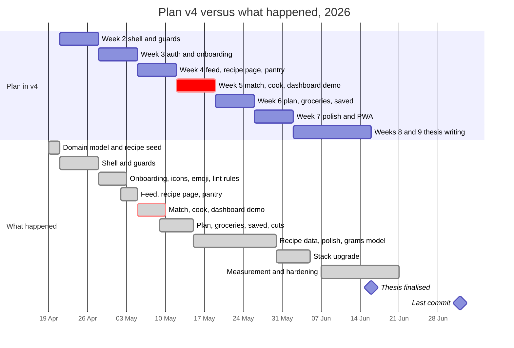

# Kookio — product history

> **What this file is.** [ARCHIVE.md](ARCHIVE.md) explains what Kookio does, how it works and how
> to run it again. This file explains how it came to be that way: where the idea came from, how
> the plan changed, which decisions shaped the product, what was cut, what was designed and never
> built, and what the project teaches.
>
> It condenses three sources:
>
> - **The planning documents**, written in Romanian and kept outside this repository: seven
>   versions each of a _Technical Document_ and a _Product Vision_ (v3 to v5.4, 13 April – 14 May
>   2026), a consolidated "single source of truth" that replaced them, the weekly task briefs, and
>   the follow-up plans written up to June 2026.
> - **The git history**: 414 commits across all branches, the merged pull requests #11–#40, and
>   the planning issues #1–#10.
> - **ARCHIVE.md**, for how everything works.
>
> Claims about the code were checked against the repository and its history on 9 October 2026.
> Where a planning document disagrees with the code, the code wins. The disagreements that matter
> for reading this history are listed in [section 10.2](#102-errata).

**Reading guide.**

- Section 1 tells the whole story on one page.
- Section 4 explains the twelve decisions that mattered most.
- Appendix A lists every decision.
- Dates without a year are in 2026.
- "v4", "v5.3" and the like are versions of the planning documents (Appendix B).
- Decision IDs such as `ARCH-04` follow the consolidated planning document, with English prefixes.

## At a glance

|                           |                                                                                                                                                                                                                                                                                                              |
| ------------------------- | ------------------------------------------------------------------------------------------------------------------------------------------------------------------------------------------------------------------------------------------------------------------------------------------------------------ |
| **The idea**              | A pantry-first cooking companion: record what is in your kitchen, see what you can cook with it, plan your meals and buy only the difference. It was the first of three planned products and the only one built. It became the case study of a bachelor thesis on the PAN architecture (Prisma, Analog, Nx). |
| **Lifetime**              | First commit 14 Sep 2025 · product built 19 Apr – 20 Jun 2026 · last development commit 2 Jul 2026 · archived 9 Oct 2026                                                                                                                                                                                     |
| **Planning**              | Seven versions of two documents in 31 days (13 Apr – 14 May), then task briefs. The plan was rewritten after every stage.                                                                                                                                                                                    |
| **Delivered**             | Every must-have and should-have screen of the thesis scope, 9 to 11 days ahead of the plan, and two of the five nice-to-haves                                                                                                                                                                                |
| **Cut on purpose**        | A repository layer (twice), WebAuthn, roles with `/admin` and `/403`, the `MealPlan` aggregate, recipe search, a quick-actions widget, the floating Cook-now button, the feature flags and the `core/*` libraries                                                                                            |
| **Designed, never built** | The mobile app, the AI and OCR features, products 2 and 3, live expiry alerts, staple tracking, dietary filtering and resuming a cooking session ([section 7](#7-designed-but-never-built))                                                                                                                  |
| **Why it stopped**        | It had served its purpose: the thesis was defended in July 2026. In October the author's priorities moved to preparing for a master's degree in AI.                                                                                                                                                          |

## Contents

1. [The arc in brief](#1-the-arc-in-brief)
2. [Timeline](#2-timeline)
3. [The product: vision, scope and delivery](#3-the-product-vision-scope-and-delivery)
4. [Twelve decisions that shaped it](#4-twelve-decisions-that-shaped-it)
5. [Patterns across the decisions](#5-patterns-across-the-decisions)
6. [Plan versus delivery](#6-plan-versus-delivery)
7. [Designed but never built](#7-designed-but-never-built)
8. [Assessment](#8-assessment)
9. [Lessons](#9-lessons)
10. [Sources and errata](#10-sources-and-errata)

- [Appendix A. Decision register](#appendix-a-decision-register)
- [Appendix B. The planning documents](#appendix-b-the-planning-documents)

---

## 1. The arc in brief

**A technical exercise first.** Kookio began on 14 September 2025 as an Nx workspace with an
AnalogJS app that served a list of ingredients over tRPC. By January 2026 it had what a product
would need: Prisma on CockroachDB, CI on GitHub Actions, deployment to Vercel and three
environments. On 7 January, ten "epic" issues laid out a generic platform roadmap: an
access-control schema, a Firebase adapter, WebAuthn, a PWA stub, a design system and an Ionic
pilot. Work stopped on 19 January and did not resume for three months.

**The product plan arrived in April, on paper first.** Version 3 of the planning documents
(13 April) described three products: a personal pantry manager, a coaching platform for
nutrition experts and a "social network with integrity". It chose the first as the case study
for a bachelor thesis on the PAN architecture. The first product commit, on 19 April, brought the
domain model, Firebase authentication and about 595 recipes from TheMealDB. From there the
documents changed almost weekly:

- **v4 (21 April)** dropped a nine-week plan built around an Ionic mobile app in favour of the
  web: a PWA now, a native app after the thesis. It split the thesis scope into must-have,
  should-have and nice-to-have screens.
- **v5 (27 April)** split every document into a _Reality_ part, checked against the code, and a
  _Plan_ part. v4 had described much of the plan as if it already existed.
- **v5.1 to v5.4 (2–14 May)** tracked a build that ran ahead of the plan. The end-to-end demo
  worked on 9 May instead of 18 May, and the should-have screens were done on 14 May instead of
  25 May. Along the way, most of the January platform was deleted: WebAuthn and roles in May,
  the feature flags and the `core/*` libraries in June.

**Five weeks of depth.** With the scope done by mid-May, the next five weeks went into depth
rather than breadth:

- structured recipe steps with estimated servings and difficulty;
- one grams model shared by cooking and shopping;
- an upgrade to Angular 21 and Prisma 7;
- a strict Content Security Policy, error reporting and rate limiting;
- reproducible measurements for the thesis.

**The end.** The thesis was finalised on 16 June and the last application code was written on
20 June. The last development commit is from 2 July, and the thesis was defended in July.
Nothing happened in August or September. Kookio was archived on 9 October 2026.

Five forces explain most of the decisions ([section 5](#5-patterns-across-the-decisions)):

- a fixed thesis deadline;
- the habit of checking documents against the code;
- a readiness to delete what nothing used;
- platform constraints that dictated the architecture;
- recipe data that capped what the product could do.

---

## 2. Timeline

### 2.1 Phases

| When              | Phase                         | What happened                                                                                                                                                                                                                                                                       | Decisions                                      |
| ----------------- | ----------------------------- | ----------------------------------------------------------------------------------------------------------------------------------------------------------------------------------------------------------------------------------------------------------------------------------- | ---------------------------------------------- |
| 14 Sep – Oct 2025 | Bootstrap                     | Nx, AnalogJS and Playwright; ingredients over tRPC from mock data; Prisma with generated Zod (18 Oct); Apache 2.0 licence, a README and the "PAN stack" name (23 Oct); Postgres replaced by CockroachDB (25 Oct); a first repository layer (28 Oct)                                 | ARCH-01, DATA-01, ARCH-06                      |
| Nov – Dec 2025    | Plumbing                      | Prisma split into libraries, with a transaction-retry helper (18 Nov); CI paused, then rebuilt; separate dev, test and prod pipelines and the first successful production deployment on Vercel (21 Dec); the `apps/` and `libs/` layout; git hooks                                  | QA-04                                          |
| Jan 2026          | A platform roadmap            | Redis and rate limiting (1 Jan); modular CI (2 Jan); ten epic issues (7 Jan); `core/*` libraries with feature flags for WebAuthn, the PWA and an Ionic shell (19 Jan)                                                                                                               | PROD-08                                        |
| 20 Jan – 18 Apr   | Pause                         | No commits. Version 3 of the planning documents is dated 13 April.                                                                                                                                                                                                                  | —                                              |
| 19 – 27 Apr       | Domain model and plan         | The thesis domain model, Firebase authentication and the recipe seed (19 Apr); the repository layer removed again (20 Apr); the seed cut to 54 recipes to save CI time, and v4 (21 Apr); the responsive shell; v5 (27 Apr)                                                          | ARCH-06, MOB-01, PROD-03, QA-07                |
| 28 Apr – 4 May    | Onboarding and first features | Onboarding; self-hosted icons and emoji and custom lint rules, all unplanned; the feed, recipe page and pantry in three days; the browser-safe `/server` split; v5.1 and v5.2                                                                                                       | DS-04, DS-05, QA-02, ARCH-04, API-04           |
| 5 – 9 May         | Buffer week                   | Matching, cooking and the dashboard: the end-to-end demo, nine days early; WebAuthn removed; auth pages rebuilt; navigation reorganised around tasks; v5.3                                                                                                                          | FEAT-03, FEAT-04, AUTH-06, UX-02               |
| 9 – 14 May        | Sprint                        | Planning, groceries and saved recipes; the `MealPlan` aggregate dropped; the floating button moved to the top bar; roles removed; v5.4                                                                                                                                              | DATA-08, UX-03, AUTH-05, API-06                |
| 15 – 29 May       | Depth and polish              | Titled steps, servings and difficulty, with all 594 recipes back (22 May); vertical step rails and deep links; error pages, `/about`, theming and PWA assets in one day (23 May); the grams model (28 May)                                                                          | DATA-10, FEAT-10, FEAT-11, UX-05               |
| 30 May – 4 Jun    | Stack upgrade                 | Angular 21, AnalogJS 2, Nx 22, Vitest 4, Prisma 7 and Zod 4 (30 May); match levels renamed in the API (31 May); two version bumps rolled back (3 Jun); zoneless change detection (4 Jun)                                                                                            | INF-08, API-10, INF-10                         |
| 7 – 13 Jun        | Measurement and performance   | Category and cuisine filters on the server; docs aligned with the code; `withTxRetry` deleted; optimised images; Playwright page objects; benchmarks for the thesis                                                                                                                 | API-11, API-13, INF-07, QA-08, QA-14           |
| 12 – 20 Jun       | Hardening                     | Feature flags and `core/*` removed; Sentry; rate limiting and safer registration; database timeouts and a Redis keep-alive; the reload fix; an 80 % coverage floor; self-hosted fonts and a CSP nonce; Nx Cloud; CI cuts after the Actions quota ran out. Thesis finalised 16 June. | ARCH-09, AUTH-08, INF-05, INF-09, QA-09, QA-11 |
| 21 Jun – 2 Jul    | Coda                          | One test fix (2 Jul). Three commits made on 17 June stayed on `dev` until the archive.                                                                                                                                                                                              | —                                              |
| Jul – Sep         | Defence, then silence         | Thesis defended in July; no commits in August or September                                                                                                                                                                                                                          | —                                              |
| 9 Oct             | Archive                       | ARCHIVE.md and this file; the full ingredient catalog restored; the `dev`-only commits merged; `v1.0.0` tagged; deployment paused; repository archived                                                                                                                              | PROD-09                                        |

Commits per month, across all branches, counted before this file was added:

| Year | Month     | Commits |
| ---- | --------- | ------: |
| 2025 | September |       4 |
| 2025 | October   |      11 |
| 2025 | November  |       9 |
| 2025 | December  |      24 |
| 2026 | January   |       9 |
| 2026 | April     |      80 |
| 2026 | May       |     179 |
| 2026 | June      |      89 |
| 2026 | July      |       1 |
| 2026 | October   |       8 |

February, March, August and September 2026 have none. Merged pull requests: 5 in April, 22 in June
and 3 in October. Everything else, May included, was committed directly.

### 2.2 Plan versus what happened

The build ran 9 to 11 days ahead of the plan. The time saved did not go into new screens. It
went into depth, an upgrade and hardening (section 6.2).

---

## 3. The product: vision, scope and delivery

### 3.1 The vision

The vision did not change from v3 to v5.4:

> Reduce food waste by organising resources intelligently, connect people through food, and build
> a community based on integrity and verified information.

Its guiding principle: people, not algorithms, are at the centre of the cooking experience. Three
products were to grow from it, one after another:

|          | Product 1: personal pantry manager                                                                        | Product 2: coaching platform                                                                                                 | Product 3: social network with integrity                                                                                                                                              |
| -------- | --------------------------------------------------------------------------------------------------------- | ---------------------------------------------------------------------------------------------------------------------------- | ------------------------------------------------------------------------------------------------------------------------------------------------------------------------------------- |
| **For**  | One person or household organising their kitchen                                                          | An expert (nutritionist, coach, doctor) and a small group                                                                    | A community                                                                                                                                                                           |
| **Idea** | Track what you have and when it expires; cook from it; plan your meals; buy only what the plan is missing | The expert invites users, writes their meal plans and exchanges feedback with them; recipes are shared only within the group | A chronological or relationship-based feed with no engagement algorithm; moderation by AI, then by the community, then by a small human team; green, orange and red credibility marks |
| **Fate** | Built: this repository                                                                                    | Never coded. It would have needed user roles again, redesigned as expert, user and admin.                                    | Never coded                                                                                                                                                                           |

Every version listed the same selling points:

- pantry, recipes and meal plan integrated natively;
- the progressive filter: "cook with what you have, don't buy what you don't need";
- later, a social layer without a toxic algorithm.

Four open questions were never answered:

- What do competing coaching products offer?
- Which hybrid moderation models scale?
- How would each product make money: freemium, SaaS or ethical advertising?
- After the thesis, should the mobile app come first, or the AI features?

### 3.2 The thesis scope and what shipped

v4 sorted the screens into three tiers. If time ran out, the thesis committee would still see a
complete flow: the five-minute demo was built on the must-haves alone.

| Tier                   | Planned in v4                                                                                                                                                                                                 | Outcome                                                                                                                         |
| ---------------------- | ------------------------------------------------------------------------------------------------------------------------------------------------------------------------------------------------------------- | ------------------------------------------------------------------------------------------------------------------------------- |
| Must-have, 10 screens  | `/`, `/recipes/:id`, `/login`, `/register`, `/onboarding`, `/dashboard`, `/pantry`, `/recipes/match`, `/cook/:recipeId`, `/404`. The demo flow: onboarding → pantry → match → cook → confirm → pantry updated | All built; the demo flow worked on 9 May                                                                                        |
| Should-have, 3 screens | `/recipes/saved` (one flat list of favourites), `/meal-plan` (later `/plan`), `/shopping-list` (later `/groceries`)                                                                                           | All built by 14 May                                                                                                             |
| Nice-to-have           | `/about`, `/403`, restarting onboarding from `/account`, a read-only `/admin`, several recipe collections                                                                                                     | Restart onboarding (2 May) and `/about` (23 May) built; `/403` and `/admin` removed with roles; several collections never built |

Three compromises were accepted for the thesis:

- no checks across days in the meal plan;
- no unit conversion in the shopping list;
- a single collection of saved recipes.

The grams model of 28 May later gave the shopping list a unit model anyway.

### 3.3 How each part of the product evolved

**Onboarding.** v3 planned a fridge step, utensils, household size and dietary restrictions.
v4 turned that into six steps: welcome, fridge (with category and cuisine tabs), utensils,
household, restrictions and a summary. It also made skipping a legitimate choice.

- Built 29 April – 2 May, with four seeded catalogs and one transactional commit.
- Its store was page-scoped from the start, although the brief asked for a root store. One
  user's choices therefore cannot leak to the next.
- v5.3 added the display name and pantry items staged in the fridge step.
- On 22 May it moved to the same vertical step rail as the cook page.
- A June fix (#27) stopped a hard reload on a gated page from bouncing users back to step 0.
- The dietary restrictions it collects never filtered a single recipe (section 7).

**Pantry.** v3 promised expiry dates, colour coding and push notifications.

- Built 2–4 May: listing, adding, editing and deleting; green, orange and red expiry colours; one
  dialog for adding and editing; catalog autocomplete.
- The database allows one row per ingredient. A duplicate add is a conflict, and quantities
  change by editing.
- From 26 May it accepted bought groceries; from 28 May it counted in grams.
- Push notifications never came, and staples used "to taste" never run out.

**Recipes and the feed.** v4 planned a public feed on `/`; v5 found that `/` was only a redirect
to a stub.

- Built 2–4 May: a virtual-scrolling feed with cursor pagination, and a server-rendered recipe
  page.
- On 22 May every recipe gained titled steps, servings and a difficulty, and the feed went back
  to all 594 recipes.
- In June the cards moved to optimised images and to a virtual scroll that measures each card
  itself.
- A title search was planned for week 5 and dropped.

**Matching ("Cook with what you have").** Every version has the progressive filter: recipes you
can cook now, recipes missing a little, all recipes.

- Built on 5 May as a set difference on ingredient identity that ignores quantities and "to
  taste" lines.
- The levels became Alright, Almost and All: in the UI in v5.3, in the API on 31 May.
- Category and cuisine filters were added on 7 June, but no screen ever sends them.
- See section 4.5.

**Cooking.** v3 asked for clear steps and a confirmation of the quantities used; v4 added
automatic deduction from the pantry.

- Built in the buffer week (5–9 May; the router on 6 May): sequential steps, a confirmation
  dialog, and the deduction in one transaction.
- Its server loader first called an authenticated procedure, which failed on client-side
  navigation. v5.4 moved it to public data (section 4.8).
- On 22 May the horizontal stepper became a vertical rail over titled steps, which "keeps every
  step label visible while cooking", with `?step=N` deep links.
- On 28 May the deduction moved to grams.
- Resuming a session after a reload was planned and never built.

**Dashboard.** v4 planned four widgets: quick actions, expiring soon, today's plan and a
shopping count. The quick actions were removed on 9 May, because the tabs and the Cook-now button
already did their job. A saved-recipes widget took the fourth place on 13 May.

**Meal planning.** v3 planned up to seven days of three meals; v4, a seven-by-three calendar,
tapped on mobile and dragged on desktop.

- The brief proposed saving every slot the moment it changed. The build (9 May) instead treated
  the plan as a draft saved as a whole.
- Drafts survive reloads, in `localStorage` and, from 13 May, in Redis.
- On 10 May the `MealPlan` aggregate was dropped, and the calendar became a three-day window that
  works the same on every screen. On desktop, recipes can be dragged in from a sidebar; on any
  screen, an empty cell opens a recipe picker.
- There is no servings control: every slot is saved with 2 servings.

**Groceries** (planned as the "shopping list"). It was always the plan minus the pantry, and was
renamed in v5.3.

- The brief kept the "bought" ticks in the browser. The build (12 May) stored them in Redis
  behind a circuit breaker, so they survive across tabs and visits. It later mirrored them in
  `localStorage` and answers `persisted: false` when Redis is down.
- Since 26 May, bought items move into the pantry in one transaction.
- Since 28 May, quantities merge in grams, and a pinch counts as 0.5 g "so the user is reminded
  to buy salt".
- The list counts every planned slot, past ones included.

**Saved recipes.** v3 had a `SavedRecipe` table and v4 imagined themed collections; the thesis
scope settled on one implicit "favorites" collection.

- Built on 13 May, with a bookmark on every surface and three views: flat, by cuisine and by
  category.
- Bookmarks are checked against one list of saved ids, not one request per card.
- Since 22 May, guests who press a bookmark are sent to sign in.

**Navigation and account.** See section 4.7.

- The account page gained "Restart onboarding" (2 May) and display-name editing (v5.3).
- The theme switch planned for `/account` went into the top-bar menu instead (23 May).

**Pages.**

- `/about` became a real page on 23 May. On 8 June it stopped advertising a "running low" pantry
  feature that did not exist.
- The error pages became one shared component the same day: a real 404, and `/server-error`.
  The second is named with letters because AnalogJS silently ignores page files whose names are
  all digits. Nothing ever navigates to `/server-error`.
- `/403` and `/admin` left with the roles on 13 May.

**Mobile and PWA.** v3 put an Ionic app first, with the web as a fallback; v4 reversed that
(section 4.2).

- On 23 May the PWA got a manifest, icons generated from one SVG, iOS hooks, and an install
  prompt that waits 30 seconds on mobile.
- The prompt is mounted in a root component the app never bootstraps, so it has never appeared.
- The service worker stayed an inert stub.
- The Ionic app was never started.

---

## 4. Twelve decisions that shaped it

### 4.1 Build a platform before the product (January 2026)

**Context.** By January 2026 there was infrastructure but no product. On 7 January, ten epic
issues set out a generic platform:

- contracts and core libraries;
- an identity and access-control schema;
- a Firebase auth adapter;
- access policies;
- a WebAuthn server skeleton and a WebAuthn UI;
- a PWA stub;
- a UX shell with design tokens;
- an Ionic pilot;
- end-to-end tests and observability.

**Decision.** Build that platform first. By 19 January the repository had:

- `core/config`, with environment feature flags for WebAuthn, the PWA and an Ionic shell;
- `core/logging` and `core/security`;
- a feature-flag service and guard (`5bfc566`).

Then the work paused for three months.

**What happened next.** The April product plan inherited the platform. The build then removed
most of it, piece by piece, as it found no consumer:

- WebAuthn on 8 May;
- roles and access policies on 13 May;
- the feature flags and every `core/*` library on 12 June: "fully wired but connected to
  nothing".

The PWA never grew beyond a stub. At the archive, the WebAuthn and Ionic epics were closed as
"not planned". What survived (the Firebase adapter, the shell and tokens, the test setup) is
exactly what the product used.

### 4.2 Web first, mobile later (v4, 21 April)

**Context.** v3 treated an Ionic app as the full experience, with the web as a fallback, and
scheduled an Ionic pilot for week 8.

**Decision.** One Angular and AnalogJS build, server-rendered and installable as a PWA. An Ionic
and Capacitor app would follow only after the thesis, as a separate build in the same monorepo.

**Why.**

- Angular's server rendering cannot hydrate Ionic's web components, which are built with
  Stencil.
- Capacitor plugins break on the server ("window is not defined").
- Two builds would cost time better spent completing the flow.
- A PWA was estimated to give about 80 % of a native app's visual impact for about 40 % of the
  effort.

**What happened next.** The native app was never started, and the PWA stayed partial
(section 3.3). Some later choices were justified partly by the future mobile app: a browser-safe
`prisma-client` root for it to consume, and design tokens that would map onto Ionic's. That
benefit was never collected.

### 4.3 Reality before plan (v5, 27 April)

**Context.** v4 presented much of the plan as fact:

| v4 claimed                                  | The code had      |
| ------------------------------------------- | ----------------- |
| 21 tables                                   | 19                |
| ten feature libraries                       | two               |
| middleware and a `hasProfileSignals` signal | neither           |
| five tabs                                   | four              |
| a feed on `/`                               | a redirect        |
| a flat colour palette                       | Material 3 tokens |
| integration tests against a real database   | none              |

**Decision.** From v5, every document had a _Reality_ part, checked in the code, and a _Plan_
part. Every change was marked against the previous version.

**Why.** A plan written as fact misleads the next decision.

**What happened next.** The split held through v5.4 and outlived the documents. The thesis
checks, the debugging chapter in `.ai/` ("trust the source, not the summary") and ARCHIVE.md all
follow it. It made drift visible but did not stop it: even v5.3 and v5.4 describe a
`feature/cook` library that never existed, and a tab bar that had already changed
(section 10.2).

### 4.4 One source of truth for types, safe in the browser (4 May)

**Context.** `schema.prisma` generates the Zod schemas that every layer uses. On 4 May two
problems surfaced:

- A runtime import of a generated schema pulled the Prisma client into the browser bundle and
  crashed hydration (`e77c921`).
- An injection token imported from a feature library's barrel into `app.config.ts` stretched
  the cold server render of `/login` in development from about 6 s to about 58 s.

**Decision.**

- The root of `@kookio/prisma-client` exports only types and Zod schemas.
- The Prisma client sits behind `@kookio/prisma-client/server`, which ESLint bans in front-end
  code (`3af8749`).
- Feature tokens move to light sub-paths such as `@kookio/feature-pantry/trpc`.

**Alongside it.** The same week, onboarding failed with 13 "Invalid uuid" errors. The input
schema expected UUIDs, but the seed had given utensils and restrictions readable ids such as
`utensil_chef_knife`.

- Ids got two named schemas, chosen by how each id is produced. The principle: validation
  strictness mirrors data reality.
- It survived the move to Zod 4, whose stricter `uuid()` would have rejected hand-written ids.
  `UuidIdSchema` switched to the looser `guid()` on purpose (30 May).

**What happened next.** Both rules held to the end and are written into the `.ai/` chapters. The
lesson that outlived them: with server rendering, the cost of an import is paid on every route.

### 4.5 Match on presence, not quantity (5 May)

**Context.** The product's core question is "what can I cook now?". The filter was in every
version: A (I have everything), B (I am missing a little), C (all recipes).

**Decision.** A recipe line counts as present if the pantry holds that catalog ingredient,
whatever the quantity. Lines measured "to taste", "to serve", "garnish" or "pinch" never block a
recipe. The levels:

- Alright: nothing missing;
- Almost: one to three ingredients missing;
- All: no filter.

Built in `43f0fd4`, renamed in `2bb8638`.

**Why.** It is simple, fast and easy to explain. An occasional false positive (100 g of flour in
the pantry for a recipe that needs 200 g) was judged cheaper than unit logic at the matching
boundary.

**What happened next.** The grams model of 28 May made quantity-aware matching possible. The
thesis sketches it, but it was never built.

The real ceiling turned out to be the data. Matching uses exact ingredient identity, and the
catalog holds both generic and specific variants (`flour`, `plain_flour`, `all_purpose_flour`).
Stocking one never satisfies a recipe that asks for another.

### 4.6 Delete what nothing uses (April – June)

Each of these was built, kept for a while, then removed once it was clear that nothing used it.

| What                         | Built                     | Removed            | Why it went                                                                     |
| ---------------------------- | ------------------------- | ------------------ | ------------------------------------------------------------------------------- |
| A repository layer           | 28 Oct 2025; again 19 Apr | 20 Apr (`408940a`) | Boilerplate over an already typed Prisma client; tRPC is the business layer     |
| Recipe search                | Planned in v5.1 and v5.2  | 8 May (`eff99eb`)  | Matching already covered the useful filtering                                   |
| WebAuthn                     | The January platform      | 8 May (`89e46da`)  | A placeholder no screen used                                                    |
| The quick-actions widget     | Early May                 | 9 May (`a8837a9`)  | It duplicated the tabs and the Cook-now button                                  |
| The `MealPlan` aggregate     | 19 Apr, in the schema     | 10 May (`07675ea`) | Its date range was vestigial and "the parent did no work"                       |
| The floating Cook-now button | Week 2 (21–27 Apr)        | 11 May (`dfa3b91`) | The top bar gave the same visibility with less space and no clash with the tabs |
| Roles, `/admin` and `/403`   | The January platform      | 13 May (`9915d75`) | No router called the role builder; `/admin` was a stub                          |
| Feature flags and `core/*`   | 19 Jan                    | 12 Jun (#17)       | "Fully wired but connected to nothing"                                          |
| `withTxRetry`                | 18 Nov 2025               | 8 Jun (`7894c73`)  | It had no call sites (but see below)                                            |

**What it bought.**

- The schema went from 21 models to 19, before `RecipeStep` brought it back to 20.
- The auth surface shrank from four guards to three, and the routers got simpler.
- A typed stack made each deletion cheap to prove safe: when nothing consumes a type, nothing
  breaks.

**What it cost.**

- Coaching (product 2) would need roles again. By design, that would be a new model, not a
  revert.
- One deletion rested on a false premise. `withTxRetry` had no callers, but the commit that
  removed it said no router ran an interactive multi-write transaction, and four did. Those four
  transactions are still not retried as a whole.

### 4.7 Navigate by task, not by content (9 May)

**Context.** The tab bar started on 21 April as Home, Rețete, Pantry, Plan and Cont: Romanian
labels, translated five days later. It lost the Recipes tab on 27 April, when navigation was
consolidated, and regained it on 2 May.

**Decision.** One list of five destinations now feeds both the mobile tabs and the desktop side
navigation: Dashboard, Saved, Pantry, Plan and Groceries (`027cc91`).

- Labels are one word long, "so the bottom bar fits iPhone SE without truncation".
- Account moved to the top-bar menu and Home to the logo; the public feed stayed on `/`.
- The Cook-now button was pointed at matching. Two days later it moved from a floating button
  into the top bar.

**Why.** The tabs became the product's own loop (what I have, what I plan, what I buy, what I
keep) instead of a site map.

**What happened next.** The navigation never changed again. The planning documents never caught
up: v5.3 and v5.4 still list Home, Recipes, Pantry, Plan and Account.

### 4.8 Authenticated data stays in the browser (14 May)

**Context.** v5.3 used an authenticated procedure in the cook page's server loader. On
client-side navigation, AnalogJS runs page loaders as plain fetches without the Firebase token,
so the loader failed with a 401. Finding the cause took about two days.

**Decision.**

- Server loaders call public procedures only.
- Authenticated data loads in the browser.
- Guards render optimistically on the server and decide after hydration.

**What happened next.** Only the recipe and cook pages ever rendered their data on the server.
Every other page renders as a shell and fills in after hydration, which was verified on
production on 9 October. In June the Content Security Policy needed a nonce on every page, so
prerendering was dropped and every route became server-rendered (16 June). That included
`/about`, which had been prerendered since November 2025.

### 4.9 Make the recipe data usable (22 May)

**Context.** TheMealDB recipes are crowd-sourced free text, which caused three problems:

- Splitting the instructions naively turned section titles into empty "steps": one recipe showed
  ten steps instead of five.
- There was no servings field, so the interface assumed 4.
- There was no difficulty.

On top of that, the seed had been cut to 54 recipes on 21 April. Seeding all of them took about
15 minutes on every CI run.

**Decision.** Clean the data offline, and store structure instead of text (`3532709`):

- a step parser that separates titles from content;
- servings estimated from bulk mass (400 g per serving, clamped to 1–12);
- a difficulty computed from ingredients plus twice the steps, against the median;
- hand corrections on top of all three;
- a `RecipeStep` model and a `Difficulty` enum, with `Recipe.instructions` dropped;
- all 594 recipes and 2,998 titled steps back in the seed.

The migration was written by hand, because Prisma's shadow database hangs on CockroachDB.

**What happened next.** Recipe pages, the cook rail and difficulty chips became possible, and
recipes without steps were dropped from the seed (25 May). Servings and difficulty are
estimates, not facts.

The pipeline lives in the thesis repository. That is how the recipes came back while the
ingredient catalog stayed trimmed for five and a half months, until the archive (`868e770`).

### 4.10 One grams model for cooking and shopping (28 May)

**Context.** Cooking and shopping both compare quantities written in different units: a recipe
asks for 2 cloves, the pantry holds 50 g. On 26 May a converter between units of the same family
(`25a4be3`) stopped such mismatches from silently skipping the pantry deduction. It lasted two
days.

**Decision.** Every quantity converts to grams through two pure functions, `toGrams` and
`fromGrams`, shared by the app and the offline data pipeline (`d1c55cf`, `51ea353`).

- Counted items use a per-ingredient `pieceGrams` (32 values), or 100 g when unknown.
- "To taste", "to serve" and "garnish" count as 0 g; a pinch counts as 0.5 g.
- The cook deduction deletes a pantry row when less than 0.5 g would remain.
- The shopping list and the pantry merge quantities in grams.

**Why.** "Closing the consistency gap between the two contexts": the data pipeline estimated
grams one way and the app another.

**What happened next.** Deductions and merges became deterministic, and the thesis presents the
unification as one of its patterns. The cost of 0 g is that salt and oil never run out in the
app. That is where the staple-tracking plan came from (section 7).

### 4.11 Upgrade the stack before the defence (30 May – 4 June)

**Decision.** Move everything to current major versions in one unit (`815fff9`):

- Angular 20 → 21, AnalogJS 1.21 → 2.5, Nx 21 → 22, Vitest 3 → 4;
- Prisma 6.17 → 7.8, with its driver adapter and `prisma.config.ts`;
- Zod 3.25 → 4.4, Vite 8, ESLint 10;
- then zoneless change detection (4 June), since change detection was already driven by signals.

**Why.** The commits do not say why the upgrade happened then. The merge notes that Prisma 7, "a
structural migration, not a version bump", was validated against the live database first.

**What it cost.**

- Within four days, two bumps were rolled back. Angular 21's build tooling rejects Vite 8, and
  sharp 0.34 broke the Vercel install against AnalogJS's peer range.
- The test setup had to be rebuilt for CI.
- A lockfile rule was written, then withdrawn the next day.
- Five version ceilings (tRPC 10, marked 15, TypeScript 5.9, Vite 7, sharp 0.33) are now part of
  the revival notes ([ARCHIVE.md, section 10.5](ARCHIVE.md#105-upgrading)).

**What it bought.** The thesis described a current stack, and the archive starts from one.

### 4.12 Lock it down (12–20 June)

**Decision.** In a little over a week, the app went through a security and reliability pass:

- Rate limiting moved to the tRPC handler and became fail-open: "a Redis outage must never 500
  the endpoint it protects".
- Registration began verifying the Firebase token's uid and email. Until then it had stored a
  client-supplied uid as the user's id.
- Database queries got timeouts and a connection cap, and token verification got a timeout.
- Sentry arrived on the client and the server, followed by source maps and then filters against
  noise.
- A strict Content Security Policy and HSTS went into `vercel.json`, and the fonts were
  self-hosted.

**What happened next.** The strict policy blocked the app's own inline scripts in production,
without failing a single test:

- the script that prevents a flash of the wrong theme;
- the service-worker registration;
- Angular's event replay.

Two days later a Nitro plugin stamped a per-request nonce on every inline script (#31). The
sitemap and prerendering went, so that every page passes through the server.

---

## 5. Patterns across the decisions

### 5.1 The plans ran ahead of the code, and were pulled back

Fourteen planning documents appeared in 31 days, each one correcting the last.

- v4 declared things that did not exist. v5 split reality from plan.
- Even after that, the documents described the briefs rather than the code in places:
  - a `feature/cook` library;
  - per-slot `setSlot` and `clearSlot` procedures for the planner;
  - an `isSaved` query per recipe;
  - the old tabs.

The build kept diverging from the briefs, mostly for good reasons:

- the planner saves a whole draft;
- bought ticks live in Redis;
- the theme switch sits in the top bar;
- end-to-end tests run on pushes to `test`.

The documents caught some of these divergences and missed others. What survived is the habit of
checking against the code before writing anything down. ARCHIVE.md and this file are both
products of it.

### 5.2 Most of the simplification was deletion

Nine things were removed after being built (section 4.6), and the January platform supplied most
of them. The typed stack made each removal safe to prove. The one overreach was `withTxRetry`,
whose deletion rested on an unchecked claim.

### 5.3 The platform set the architecture

Constraints from the tools, rather than preferences, decided much of the structure:

| Constraint                                                                                  | What it forced                                                                                  |
| ------------------------------------------------------------------------------------------- | ----------------------------------------------------------------------------------------------- |
| AnalogJS page loaders carry no auth token on client navigation                              | Public-only server loaders (section 4.8)                                                        |
| AnalogJS ignores page files with all-digit names                                            | `/server-error`, not `/500`                                                                     |
| Vite's dev server does not tree-shake barrel files                                          | Sub-path exports and the `/server` split (section 4.4)                                          |
| A Sass importer bug in `nxViteTsPaths()`                                                    | A global stylesheet in plain CSS, with design tokens loaded through a `<link>` tag              |
| Tailwind's preflight reset collides with Material's form fields                             | Targeted border resets in `kookio-material.css`                                                 |
| CockroachDB's serializable isolation and migration quirks                                   | A per-statement retry extension, hand-written migrations and a migration guard                  |
| Angular's server rendering cannot hydrate Ionic                                             | Web first (section 4.2)                                                                         |
| Splitting bundles by hand (`manualChunks`) produced blank pages                             | No bundle surgery; a 6 GB build heap instead                                                    |
| The free Redis tier deletes idle instances (one was lost in February and discovered in May) | State that degrades to `localStorage` with a `persisted: false` answer, and a weekly keep-alive |
| The GitHub Actions quota ran out in June                                                    | CI cuts, and six pull requests (#32–#37) merged without CI between 17 and 20 June               |

### 5.4 The data set the ceiling

Most product limits trace back to the recipe data from TheMealDB:

| Problem in the data             | Consequence                                           |
| ------------------------------- | ----------------------------------------------------- |
| Instructions were free text     | A step parser                                         |
| No servings or difficulty       | Heuristics                                            |
| No preparation or cooking times | Those fields are empty for all 594 recipes            |
| Ingredient variants             | The matching ceiling (section 4.5)                    |
| No dietary labels               | Restriction filtering would need a labelling pipeline |
| "To taste" quantities           | 0 g, so staples are invisible                         |

The seed trims made for CI speed hid how much data was missing: 54 recipes from April to May, and
215 ingredients from April until the archive.

### 5.5 Guardrails held when they were code

Guardrails written as code held to the end:

- lint rules for icons, emoji and buttons;
- manifest checks in CI;
- module boundaries;
- the coverage floor;
- the pre-push gate;
- validation schemas.

Checks that only looked like guardrails failed silently:

- **The production smoke test** reads a URL variable that exists only on the deployment
  environments, so it skipped and still reported success.
- **The end-to-end job** tests a local server instead of the preview, and has not run since
  16 June.
- **The health endpoint** answers 200 even when the database is down.
- **The install prompt** passed its unit tests but was never on screen.
- **The strict Content Security Policy** broke production scripts while every test stayed green.
- **The planning documents** drifted from the code.

### 5.6 Speed, and the long tail it left

**Speed.** Weeks 3 to 6 of the plan took 17 days (28 April – 14 May). AI coding assistants were
part of every working day, and the process adapted to them:

- Conventions lived in the `.ai/` chapters, read at the start of each session.
- Unplanned improvements passed a filter: take them only if they cost at most 30 minutes, or
  would save at least 2 hours later. Week 3 had already lost about three days to unplanned work.
- Work was ordered so that the uncertain tasks landed before the assistant's higher subscription
  tier expired on 14 May.

**The tail.** After 14 May came five weeks of depth, upgrades and hardening, much of it fixing
what speed had left behind:

- the reload bounce;
- the Content Security Policy;
- Sentry noise;
- lockfile incidents;
- the CI quota.

Summaries, including ones written by AI assistants, were wrong often enough that checking them
became a rule (`.ai/25_debugging.md`).

---

## 6. Plan versus delivery

### 6.1 Indicators across versions

| Indicator            | v3    | v4         | v5     | v5.1   | v5.2    | v5.3                    | v5.4                     | Final (Oct)                                 |
| -------------------- | ----- | ---------- | ------ | ------ | ------- | ----------------------- | ------------------------ | ------------------------------------------- |
| Prisma models        | 7     | 21 claimed | 19     | 21     | 21      | 20                      | 19                       | 20                                          |
| Enums                | 2     | 5          | 5      | 5      | 5       | 5                       | 4                        | 5                                           |
| Routes: total / real | 9 / – | 17 / –     | 18 / 5 | 19 / 8 | 19 / 10 | 19 / 13                 | 17 / 16                  | 18 / 18                                     |
| tRPC routers         | –     | –          | 4      | 6      | 8       | 7                       | 10                       | 10, 35 procedures                           |
| Feature libraries    | 2     | 10 claimed | 2      | 3      | 5       | 6 (the document says 7) | 9 (the document says 10) | 9                                           |
| Route guards         | 3     | 4          | 4      | 4      | 4       | 4                       | 3                        | 3, plus an unsaved-changes guard on `/plan` |
| Dashboard widgets    | –     | 4 planned  | 0      | 0      | 0       | 3                       | 4                        | 4                                           |

The final schema adds `RecipeStep` and the `Difficulty` enum. The final routes add
`/server-error` and turn `/about` into a real page.

For tests, the thesis (June) reports 873 unit tests in 96 files and 14 end-to-end tests, with
82.2 % line coverage of the library source. At the archive there were 8 end-to-end specs with 16
tests.

### 6.2 Schedule

| Milestone                                     | Planned in v4 | Actual           | Difference         |
| --------------------------------------------- | ------------- | ---------------- | ------------------ |
| Shell and guards                              | 27 Apr        | 27 Apr           | on time            |
| Onboarding                                    | 4 May         | 2 May            | 2 days early       |
| Feed, recipe page, pantry                     | 11 May        | 4 May            | 7 days early       |
| End-to-end demo: matching, cooking, dashboard | 18 May        | 9 May            | 9 days early       |
| Planning, groceries, saved recipes            | 25 May        | 14 May           | 11 days early      |
| Polish and PWA                                | 1 Jun         | 23–25 May        | about a week early |
| Thesis written                                | 2–15 Jun      | finalised 16 Jun | 1 day late         |

After 14 May the scope was done, and the time saved went into work the v4 plan did not contain.
From 15 May to 20 June:

- the recipe data and the grams model;
- the stack upgrade and its fallout;
- performance work and measurement for the thesis;
- the June hardening.

All of it ran alongside the thesis writing.

### 6.3 What happened to each task brief

| Brief                                                                                                              | Planned        | Delivered      | What changed on the way                                                                                             |
| ------------------------------------------------------------------------------------------------------------------ | -------------- | -------------- | ------------------------------------------------------------------------------------------------------------------- |
| Week 2: shell, guards, the onboarding flag, the Cook-now button, route stubs                                       | 21–27 Apr      | 21–27 Apr      | The Cook-now button later moved to the top bar                                                                      |
| Week 3: preference models and catalog seed, onboarding API, store and steps, profile counters, two optional extras | 28 Apr – 4 May | 29 Apr – 2 May | Plus four unplanned changes: self-hosted icons, Twemoji, custom lint rules, the unified button API                  |
| Week 4: feed, recipe page, pantry                                                                                  | 5–11 May       | 2–4 May        | Plus the `/server` split and the two id schemas                                                                     |
| Week 5: matching, the cooking session, the match and cook pages, the dashboard, optional search                    | 12–18 May      | 5–9 May        | Search dropped; the quick-actions widget built and removed                                                          |
| Sprint: planning, groceries, saved recipes, removing roles, a smoke test                                           | 12–25 May      | 9–14 May       | A three-day window instead of a week; whole-plan saves; ticks in Redis; `MealPlan` dropped                          |
| Polish batch: error pages, `/about`, theme switch, PWA, a bug buffer                                               | 18–24 May      | 23–25 May      | Theme switch in the top bar; 403 handling and an error-code table not done; install prompt never mounted            |
| Recipe-data rework, four tasks                                                                                     | late May       | 22–25 May      | The planned `recipes-clean.json` became the cleaned `recipes.json`; the servings default went in the same migration |
| CI optimisation, seven changes                                                                                     | June           | 17 Jun         | Six done as planned; end-to-end tests moved to pushes on `test` instead of pull requests                            |
| Thesis writing                                                                                                     | 2–15 Jun       | 16 Jun         | —                                                                                                                   |

---

## 7. Designed but never built

### 7.1 The follow-up plans

These plans were written between late April and June 2026 and set aside when the author's
priorities changed. Several had in fact shipped already.

| Plan                                                    | Written    | Status on 9 October                               | Detail                                                                                                                     |
| ------------------------------------------------------- | ---------- | ------------------------------------------------- | -------------------------------------------------------------------------------------------------------------------------- |
| A Page Object Model for the end-to-end suite            | April–May  | **Shipped** 10 Jun (`e7de487`)                    | The specs contain no raw selectors; the login fixture keeps them by design                                                 |
| Docs aligned with the real library layout               | late April | **Shipped** 8 Jun (`a9ebc91`), finished 12–14 Jun | Two small drifts remain ([ARCHIVE.md, section 9.4](ARCHIVE.md#94-where-the-docs-disagree-with-the-code))                   |
| Optimised feed images through Vercel                    | May        | **Shipped** 10 Jun (`fafb6fa`), reworked 13 Jun   | Measured for the thesis: 60.5 % less image payload across the whole recipe catalog                                         |
| Decide the fate of `withTxRetry`                        | April–May  | **Decided on a false premise**, 8 Jun (`7894c73`) | Deleted on the claim that no interactive multi-write transactions existed; four do                                         |
| A library audit once the structure had matured          | late April | **Partly done**                                   | Its triggers had fired by mid-May. Only the `core/*` removal (12 Jun) and the `prisma-client` flattening (14 Jun) followed |
| Live pantry-expiry alerts (the first tRPC subscription) | late April | **Not built**                                     | See below                                                                                                                  |
| Staple depletion tracking                               | 7 June     | **Not built**                                     | See below                                                                                                                  |
| Dietary-restriction filtering                           | June       | **Not built**                                     | The category and cuisine filters it would sit beside exist on the server only                                              |
| Resuming a cooking session after a reload               | June       | **Not built**                                     | See below                                                                                                                  |

What the unbuilt four would take:

- **Live expiry alerts.**
  - The design: a `notifications.onPantryExpiring` subscription. On connect it sends a snapshot
    of the items expiring within a few days, then pushes updates through a per-user Redis
    channel.
  - The feed: either a daily scan or events scheduled when an item is saved.
  - The UI: a top-bar badge with a dropdown.
  - The plan's first step was a hosting check: can the deployment hold WebSocket connections at
    all? The answer decides between WebSockets, server-sent events and a hosted service.
  - Push and email reminders were separate plans.
- **Staple tracking.** A stock state per item (in stock, running low, out) for flavour-only
  ingredients. It feeds the shopping list without inventing grams. A post-cook "did you run low
  on salt?" prompt would be a later step. Details in
  [ARCHIVE.md, section 9.2](ARCHIVE.md#92-unfinished-work).
- **Dietary filtering.** A join between recipes and dietary restrictions, filled by an offline
  derivation.
  - Vegetarian, pescatarian, dairy-free and nut-free follow from ingredient categories.
  - Vegan and gluten-free need ingredient-level lists, because eggs, honey and wheat are not
    categories.
  - Recipes that cannot be classified would be excluded, the safe default for a dietary filter.
- **Resuming a cooking session.** A `cookingSession.active` query, an idempotent `start` that
  reuses the open session, and a restore on page load that takes the step from `?step=`. No
  migration is needed.

### 7.2 Loose ends from the briefs

| Item                                                | From                     | State                                                                   |
| --------------------------------------------------- | ------------------------ | ----------------------------------------------------------------------- |
| 403 handling in the client, and an error-code table | Polish batch             | Not done. The server never returns 403: the onboarding gate answers 412 |
| Sending server errors to `/server-error`            | Polish batch             | The page exists; nothing navigates to it                                |
| Mounting the install prompt                         | Polish batch             | Built and tested, never mounted                                         |
| Lighthouse results in the repository                | Polish batch             | Only in the thesis: 93 on desktop, 58 on mobile                         |
| A Redis cache for the onboarding catalogs           | Week 3 (`TODO(post-w3)`) | Never needed                                                            |
| Moving `searchIngredients` into its own router      | Week 4 (`TODO(post-w4)`) | Not done                                                                |
| Feed filters by category and cuisine                | Week 5                   | Reserved in the API, never sent                                         |
| Preparation and cooking times                       | The schema               | Empty for all 594 recipes                                               |
| Remembering the onboarding step across a reload     | —                        | Not done                                                                |

### 7.3 The roadmap that never started

| Idea                                                                               | Since | Notes                                                       |
| ---------------------------------------------------------------------------------- | ----- | ----------------------------------------------------------- |
| An Ionic and Capacitor mobile app: camera, notifications, location, store releases | v3    | Priority 1 after the thesis in every version                |
| Recommendations with embeddings ("what can I cook with this?")                     | v3    | LangChain with OpenAI or Hugging Face embeddings, pgvector  |
| Recognising ingredients from photos, and expiry dates from labels                  | v3    | Capacitor Camera with Tesseract.js or Google Cloud Vision   |
| Supermarket prices and local producers on a map                                    | v3    | eMAG, Auchan and Carrefour APIs; Google Maps                |
| Push and email reminders                                                           | v3    | The subscription plan above was the first step              |
| Product 2, coaching                                                                | v3    | Needed market research and a new role model                 |
| Product 3, a social network with integrity                                         | v3    | —                                                           |
| Several collections, user-written recipes, checks across days, unit conversion     | v4    | The schema already supports collections and private recipes |
| Cooking timers, voice navigation, pausing and resuming                             | v5.3  | —                                                           |
| Internationalisation, a content section, Open Graph images                         | v5    | Libraries installed or designed, never used                 |
| Integration tests against a real database                                          | v3    | Promised in every version                                   |

---

## 8. Assessment

### 8.1 Against its goals

**As the vehicle of a thesis: met.** The thesis on the PAN architecture was finalised on 16 June
and defended in July. Kookio is where its claims were implemented and measured. The measurements
come from the `bench:*` scripts in `scripts/`; latencies are warm medians unless noted.

| Measurement                                    | Result                                |
| ---------------------------------------------- | ------------------------------------- |
| Database round trip from the deployed function | 1.71 ms (2.07 ms at p95)              |
| Redis round trip                               | 0.56 ms                               |
| Lighthouse performance                         | 93 on desktop, 58 on throttled mobile |
| Largest contentful paint                       | 1.5 s on desktop, 8.3 s on mobile     |
| Image payload saved by optimisation            | 60.5 %                                |

**As a product: the loop works; the impact is unknown.** Every flow works end to end: pantry,
matching, planning, groceries, cooking with deduction, saved recipes. No usage analytics or
behavioural data were ever collected, so there is no evidence either way that it changed anyone's
shopping. Food waste was the motivating domain, not a measured result.

**As a codebase: coherent, with sharp edges.** Types flow from one schema to the screen,
boundaries are enforced, and lint, coverage and manifest checks run in CI. At the archive, the
sharp edges were (ARCHIVE.md, sections 9.3 and 9.5):

- production is re-seeded on every push to `main`;
- the production smoke test skips, and the end-to-end job is wired to a local server rather
  than the preview and has not run in CI since 16 June;
- the health check cannot fail on the database;
- four transactions that a serialization conflict would turn into a server error.

### 8.2 What worked

- **Scoping in tiers.** A complete demo existed early, so everything after it was a bonus.
- **Checking documents against the code**, and treating deletion as a design tool.
- **One schema as the source of every type.** Renames failed at compile time, not in production.
- **Dependencies allowed to degrade.** A Redis outage costs a convenience, not a page.
- **Conventions written where the tools read them.** Lint rules, manifest checks and the `.ai/`
  chapters held up better than any prose document.

### 8.3 What did not

**Product gaps:**

- Matching hits a ceiling on ingredient variants.
- Staples are invisible.
- Dietary restrictions are asked for and then ignored.
- The planner fixes servings at 2, and the shopping list counts past meals.
- The PWA cannot be installed in practice.
- List pages arrive without server-rendered data.
- A reload in the middle of cooking loses the session.

**Process costs:**

- The documentation multiplied (fourteen planning documents, 25 `.ai/` chapters, per-library
  READMEs) and drifted.
- CI cost more minutes than the free quota allowed.
- The free tiers broke things twice.
- Several checks reported success without testing anything (section 5.5).

### 8.4 Why it stopped

Kookio stopped because it had done its job: the thesis needed a real application and got one.
The last application code is from 20 June, the last development commit from 2 July, and the
thesis was defended in July. In October 2026 the author's priorities moved to preparing for a
master's degree in AI. Instead of being left to decay, the project was archived on 9 October,
with ARCHIVE.md and this file as the way back in.

---

## 9. Lessons

1. **Keep what exists separate from what is planned, and check it again.** v4 described plans as
   facts; the v5 split made drift visible. Drift happened anyway: later documents describe a
   library that never existed and a tab bar that had already changed, and even ARCHIVE.md needed
   corrections. Every correction started from a check against the code.
2. **Build for a consumer you can name.** The January platform built WebAuthn, roles, feature
   flags and an Ionic pilot before any product needed them. All of them were removed or
   abandoned. A typed stack made the removals safe, because when nothing uses a type, nothing
   breaks.
3. **Verify the premise of a cleanup, not just its diff.** `withTxRetry` was deleted because "no
   router performs an interactive multi-write transaction". Four did. The deletion passed every
   check, because the checks tested the code, not the claim.
4. **A green check proves only what it checks.**
   - The production smoke test skipped and reported success.
   - The end-to-end job was wired to a local server instead of the preview.
   - A health endpoint answered 200 with the database down.
   - A security policy broke production with every test green.
   - An install prompt passed its tests and was never on screen.
5. **With server rendering, an import's cost is paid on every route.** One barrel import added
   about 50 seconds to the cold render of the login page in development.
6. **Platform constraints are architecture.** Loaders without tokens, a Sass importer bug,
   all-digit page names and a CSS reset clashing with Material each forced a structural choice.
   Each one is written down where the next person will look (`.ai/`).
7. **The data sets the ceiling.** Matching is only as good as ingredient identity. Heuristics
   fill gaps but stay heuristics, and a "0 g" convention quietly hides what runs out.
8. **Keep data and its provenance together.** The data pipeline lives in another repository, and
   a trimmed ingredient catalog went unnoticed for five and a half months.
9. **Free tiers have teeth.** A Redis instance was deleted for inactivity, and an Actions quota
   ran out and let six pull requests merge without CI.
10. **Speed needs a brake.** The "30 minutes, or 2 hours saved" filter kept unplanned work in
    check after week 3 had lost three days to it.
11. **Deferred usually means abandoned.** The mobile app, notifications, products 2 and 3 and the
    libraries shaped to serve them were all deferred, and none came back. Shape the architecture
    for what is committed, not for what is deferred.

---

## 10. Sources and errata

### 10.1 Sources

| Source                                                | What it covers                                                                         | Where                                                    |
| ----------------------------------------------------- | -------------------------------------------------------------------------------------- | -------------------------------------------------------- |
| _Technical Document_, v3 to v5.4                      | Architecture, data model, routes, the implementation plan, decisions                   | The author's files, in Romanian, outside this repository |
| _Product Vision_, v3 to v5.4                          | Mission, the three products, scope tiers, the route contract, the roadmap              | Same                                                     |
| The consolidated "single source of truth"             | All fourteen documents in one decision register, with indicators and its own 19 errata | Same                                                     |
| Weekly task briefs                                    | Weeks 2 to 5, the 9–14 May sprint, the polish batch, the recipe-data rework            | Same                                                     |
| The June CI optimisation plan and the follow-up plans | Section 7                                                                              | Same                                                     |
| Git history, pull requests and issues                 | 414 commits, PRs #11–#40, the epic issues #1–#10                                       | This repository                                          |
| [ARCHIVE.md](ARCHIVE.md)                              | How everything works and how to revive it                                              | This repository                                          |
| The thesis                                            | Problem statement, patterns, measurements                                              | The private repository `EduardEmanuel/kookio-thesis`     |

### 10.2 Errata

Places where a source says something the code or the history does not support:

| Source                                   | What it says                                                                                                                        | What is true                                                                                                                                          |
| ---------------------------------------- | ----------------------------------------------------------------------------------------------------------------------------------- | ----------------------------------------------------------------------------------------------------------------------------------------------------- |
| v4                                       | 21 tables, ten feature libraries, five tabs, a feed on `/`, and more                                                                | Corrected by v5 (section 4.3)                                                                                                                         |
| v4                                       | 12 ingredient categories                                                                                                            | 13: `SWEETS` existed from 19 April                                                                                                                    |
| v5.3, v5.4                               | A `feature/cook` library                                                                                                            | It never existed; the cook page lives in `apps/web`                                                                                                   |
| v5.3, v5.4                               | Tabs: Home, Recipes, Pantry, Plan, Account                                                                                          | Since 9 May: Dashboard, Saved, Pantry, Plan, Groceries                                                                                                |
| v5.3                                     | `User.displayName`                                                                                                                  | The field is `User.name`                                                                                                                              |
| v5.4                                     | Planner procedures `setSlot`, `clearSlot`, `clearRange`; `isSaved` per recipe                                                       | The planner saves a whole plan (`setMealPlan`) and keeps drafts; saved ids come from one list (`getSavedIds`)                                         |
| v5.4                                     | The match API keeps A/B/C                                                                                                           | Renamed Alright/Almost/All on 31 May                                                                                                                  |
| v5.4                                     | "14 of 19 routes real at the end of week 4"                                                                                         | 10 at the end of week 4, and 13 at v5.3                                                                                                               |
| The consolidated document                | Tailwind disappeared after v3                                                                                                       | Tailwind 4 stayed in use for layout                                                                                                                   |
| Recipe-data brief                        | The seed reads `recipes-clean.json`                                                                                                 | It reads the cleaned `recipes.json`                                                                                                                   |
| Polish-batch brief                       | The theme switch lives in `/account`                                                                                                | It lives in the top-bar menu                                                                                                                          |
| The thesis                               | The pantry has a manual "running low" mark                                                                                          | No such code exists; `/about` stopped claiming it on 8 June                                                                                           |
| An early thesis draft                    | CI got 25 % faster thanks to composite actions                                                                                      | Not supportable, and removed before submission: the pipeline was restructured in one commit and then grew                                             |
| Commit `7894c73`, `.ai/12_prisma-zod.md` | No interactive multi-write transactions                                                                                             | Four                                                                                                                                                  |
| ARCHIVE.md, before this change           | Two pull requests merged without CI; the smoke tests prove at least that the function starts; deployment to Vercel from 14 December | Six (#32–#37); the production smoke test skips without testing anything; the first successful production deployment was on 21 December. Now corrected |

---

## Appendix A. Decision register

Every decision recorded in the planning documents or the git history. "Kept" means it held until
the archive. IDs from the consolidated planning document keep their numbers, with English
prefixes (`ARH` became `ARCH`, `DATE` became `DATA`); later decisions continue each series.

### A.1 Architecture and structure

| ID      | Decision                                                                                                                         | When                                                | Status  | Why, or what happened                                                                 |
| ------- | -------------------------------------------------------------------------------------------------------------------------------- | --------------------------------------------------- | ------- | ------------------------------------------------------------------------------------- |
| ARCH-01 | The PAN stack: Prisma, Analog and Nx, TypeScript end to end, with tRPC, Zod, Firebase Auth, CockroachDB and Vercel               | Sep–Oct 2025; named in v3                           | Kept    | One language and one source of truth for types across every layer                     |
| ARCH-02 | Libraries grouped by scope (`feature`, `prisma-client`, `server`, `shared`), not by Nx's `ui` / `data-access` / `util` / `types` | Dec 2025 – Apr 2026; documented 8 Jun               | Kept    | A domain's store, UI and token live together; types live with the code that owns them |
| ARCH-03 | Boundaries enforced through `scope:*` tags and `@nx/enforce-module-boundaries`                                                   | 20 Apr (`408940a`)                                  | Kept    | Server and Prisma code cannot import front-end code, and the reverse                  |
| ARCH-04 | A browser-safe `@kookio/prisma-client` root; the Prisma client behind `/server`, banned in front-end code                        | 4 May (`3af8749`)                                   | Kept    | A runtime schema import crashed hydration                                             |
| ARCH-05 | Light sub-path exports for injection tokens                                                                                      | 4 May (v5.2)                                        | Kept    | Keeps heavy components out of every route's server render                             |
| ARCH-06 | No repository layer, DTO folder or CRUD generator; routers call `ctx.prisma`                                                     | Tried 28 Oct 2025 and 19 Apr; removed 20 and 25 Apr | Removed | Boilerplate over an already typed client                                              |
| ARCH-07 | NgRx Signal Store only; classic NgRx rejected                                                                                    | v5                                                  | Kept    | Signals first; side effects inside the store                                          |
| ARCH-08 | Feature libraries reach the server through typed injection tokens bound once in `app.config.ts`                                  | v5.2 onwards                                        | Kept    | Libraries stay testable and free of the tRPC client                                   |
| ARCH-09 | The feature-flag subsystem and the `core/*` libraries removed                                                                    | 12 Jun (#17)                                        | Removed | "Fully wired but connected to nothing"                                                |
| ARCH-10 | `libs/prisma/client` flattened to `libs/prisma-client`; a `shared/observability` library added                                   | 12–14 Jun (#18, #20)                                | Kept    | —                                                                                     |
| ARCH-11 | No bundle surgery (`manualChunks`, `ssr.external`); a 6 GB heap for the Nitro build instead                                      | Apr; Vercel heap 15 May                             | Kept    | Hand-made chunks produced blank pages                                                 |

### A.2 Data model

| ID      | Decision                                                                                         | When                                              | Status                                | Why, or what happened                                                              |
| ------- | ------------------------------------------------------------------------------------------------ | ------------------------------------------------- | ------------------------------------- | ---------------------------------------------------------------------------------- |
| DATA-01 | CockroachDB through Prisma                                                                       | 25 Oct 2025 (`4bd9654`)                           | Kept                                  | Chosen for horizontal scaling; the thesis concedes Postgres would have been enough |
| DATA-02 | The pantry as `PantryItem`, one row per user and ingredient                                      | v4; constraint 4 May                              | Kept                                  | Integrity in the database, not in a UI that counts rows                            |
| DATA-03 | A normalised ingredient catalog: unique names, 13 categories, `pieceGrams`                       | 19 Apr; `pieceGrams` 28 May                       | Kept                                  | One identity per ingredient; grams for counted items                               |
| DATA-04 | Recipes from TheMealDB through an offline pipeline                                               | 19 Apr; trimmed 21 Apr; restored 22 May and 9 Oct | Kept                                  | Real data for the demo; the trims were for CI time                                 |
| DATA-05 | `UserProfile` separate from `User`                                                               | v4                                                | Kept                                  | `onboardingDone` drives the guards                                                 |
| DATA-06 | Onboarding preferences as join tables; category emoji and cuisine flags as database columns      | v4 to v5.1                                        | Kept                                  | The fridge step's category and cuisine tabs                                        |
| DATA-07 | One flat "favorites" collection                                                                  | v4 to v5.3                                        | Kept; several collections never built | Thesis scope                                                                       |
| DATA-08 | The `MealPlan` aggregate dropped; a plan is a set of `MealSlot` rows                             | 10 May (`07675ea`)                                | Reversed v4                           | The date range was vestigial                                                       |
| DATA-09 | A display name, stored in `User.name`, collected at onboarding                                   | v5.3                                              | Kept                                  | —                                                                                  |
| DATA-10 | Structured recipes: `RecipeStep`, a `Difficulty` enum, non-null servings; `instructions` dropped | 22 May (`3532709`)                                | Kept                                  | Numbered, titled steps and a complexity indicator                                  |
| DATA-11 | Servings and difficulty estimated offline                                                        | 22 May                                            | Kept                                  | TheMealDB has neither                                                              |
| DATA-12 | The seed upserts only and runs after every migration in CI, production included                  | Dec 2025 onwards                                  | Kept, a sharp edge                    | Reproducible environments; production is re-seeded on every push to `main`         |
| DATA-13 | Hand-written migrations where Prisma's shadow database hangs on CockroachDB                      | 22 May                                            | Kept                                  | `migrate dev --create-only` hung                                                   |

### A.3 API, validation and rendering

| ID     | Decision                                                                            | When                             | Status                    | Why, or what happened                                                       |
| ------ | ----------------------------------------------------------------------------------- | -------------------------------- | ------------------------- | --------------------------------------------------------------------------- |
| API-01 | tRPC as the only application API; form actions deferred                             | v3                               | Kept                      | End-to-end types without hand-written contracts                             |
| API-02 | Procedure builders `public`, `protected` and `onboarded`; the role builder removed  | v5.2 to v5.4                     | Kept                      | One search shows each endpoint's guarantee                                  |
| API-03 | Zod schemas generated from Prisma and composed with `pick`, `omit` and `extend`     | Oct 2025                         | Kept                      | No duplicated shapes                                                        |
| API-04 | Two id schemas, `UuidIdSchema` and `SemanticIdSchema`; `guid()` after Zod 4         | 4 May; 30 May                    | Kept                      | Validation must mirror the data                                             |
| API-05 | Output validation on procedures                                                     | v5.2                             | Kept                      | Catches drift between the database and the UI at runtime                    |
| API-06 | Server loaders call public procedures only; authenticated data loads in the browser | 14 May (v5.4)                    | Reversed v5.3             | Loaders run as plain fetches without the token on client navigation         |
| API-07 | A custom `authAwareFetch` that also resolves URLs during server rendering           | v5.2                             | Kept                      | `@analogjs/trpc` does not export its own fetch helper                       |
| API-08 | Cursor pagination                                                                   | v5.2                             | Kept                      | —                                                                           |
| API-09 | Recipe search                                                                       | Planned v5.1–v5.2; dropped 8 May | Removed                   | Matching covers the useful filtering                                        |
| API-10 | Match levels renamed Alright/Almost/All in the API and moved to `shared-utility`    | 31 May (`2bb8638`)               | Reversed v5.4             | "So the API contract matches the UI vocabulary"                             |
| API-11 | Category and cuisine filters in `recipes.match`                                     | 7 Jun (`4626def`)                | Kept; no screen uses them | —                                                                           |
| API-12 | Rate limiting at the tRPC handler, per IP address, fail-open, production only       | 14 Jun (`f15514a`)               | Kept                      | "A Redis outage must never 500 the endpoint it protects"                    |
| API-13 | No transaction-level retry; `withTxRetry` deleted                                   | Added 18 Nov 2025; deleted 8 Jun | Kept, on a false premise  | The deletion assumed there were no interactive transactions; there are four |

### A.4 Authentication

| ID      | Decision                                                                                    | When                                      | Status                | Why, or what happened                                |
| ------- | ------------------------------------------------------------------------------------------- | ----------------------------------------- | --------------------- | ---------------------------------------------------- |
| AUTH-01 | Authentication independent of the provider, with Firebase as an adapter                     | v3                                        | Kept                  | —                                                    |
| AUTH-02 | A Bearer ID token verified on every request; the user loaded by email                       | April; verification timeout 14 Jun        | Kept                  | —                                                    |
| AUTH-03 | `AuthStore` with proactive refresh, one retry on 401, profile counters                      | v3 to v5.1                                | Kept                  | The counters drive `hasProfileSignals`               |
| AUTH-04 | Guards `guest`, `auth` and `onboarding`, optimistic during server rendering                 | v4; reworked 15 Jun (#27)                 | Kept                  | Since the reload fix, guards wait for the session    |
| AUTH-05 | Roles, `roleGuard`, `/admin` and `/403` removed                                             | 13 May (`9915d75`)                        | Removed               | Nothing called the role builder; `/admin` was a stub |
| AUTH-06 | WebAuthn removed                                                                            | 8 May (`89e46da`)                         | Removed               | A placeholder with no consumer                       |
| AUTH-07 | Login and registration rebuilt on Material and Reactive Forms; password complexity enforced | 9 May (`b78ebe2`, `c719f53`)              | Kept                  | The reference pattern for complex forms              |
| AUTH-08 | Registration verifies the token's uid and email                                             | 14 Jun (`f15514a`)                        | Kept                  | It had stored a client-supplied uid as the user's id |
| AUTH-09 | A 5-second safety timer on `authReady`, later instrumented                                  | 25 Apr; telemetry 17 Jun, on `main` 9 Oct | Kept, never validated | No data was ever collected                           |

### A.5 Features

| ID      | Decision                                                                                        | When                                     | Status                             | Why, or what happened                                     |
| ------- | ----------------------------------------------------------------------------------------------- | ---------------------------------------- | ---------------------------------- | --------------------------------------------------------- |
| FEAT-01 | A six-step, skippable onboarding with one transactional commit and a page-scoped store          | v4; built 29 Apr – 2 May                 | Kept                               | —                                                         |
| FEAT-02 | A pantry with expiry colours, one add/edit dialog and catalog autocomplete                      | v3; built 2–4 May                        | Kept; notifications never built    | —                                                         |
| FEAT-03 | Progressive matching on presence: Alright, Almost, All                                          | v3; built 5 May (`43f0fd4`)              | Kept                               | Cheap, explainable, blind to quantity                     |
| FEAT-04 | A cooking session with confirmation and a transactional deduction                               | v3; built 6 May (`bba21ab`)              | Kept                               | `CookingSession` records "I cooked X for N people"        |
| FEAT-05 | A dashboard of four widgets; quick actions removed                                              | v4; 9 May (`a8837a9`)                    | Kept                               | Quick actions duplicated the tabs and the Cook-now button |
| FEAT-06 | The planner as a three-day window over `MealSlot` rows                                          | 10 May (`07675ea`)                       | Reversed v4                        | No week to enforce; the same layout on every screen       |
| FEAT-07 | Groceries derived from the plan minus the pantry, with bought ticks in Redis                    | 12 May (`af765d7`)                       | Kept; the brief said browser only  | Ticks survive across tabs and visits                      |
| FEAT-08 | A public feed with virtual scrolling and a server-rendered recipe page                          | 2–4 May                                  | Kept                               | —                                                         |
| FEAT-09 | Saved recipes: one collection shown flat, by cuisine or by category, with a bookmark everywhere | 13 May (`bc35cf7`)                       | Kept                               | —                                                         |
| FEAT-10 | Vertical step rails for cooking and onboarding; `?step=N` deep links                            | 22 May (`c6186c6`, `1749ae6`, `de40125`) | Reversed the horizontal stepper    | "Keeps every step label visible while cooking"            |
| FEAT-11 | One grams model for deduction and shopping                                                      | 28 May (`d1c55cf`)                       | Kept                               | Replaced a unit converter from two days earlier           |
| FEAT-12 | Bought items moved into the pantry in one transaction                                           | 26 May (`caeaec4`)                       | Kept                               | —                                                         |
| FEAT-13 | Plans edited as drafts (kept in `localStorage` and Redis) and saved whole                       | 9–13 May (`e44cba0`, `2457e66`)          | Kept; the brief said save per slot | Unsaved edits survive reloads                             |
| FEAT-14 | A light, dark or automatic theme in the top-bar menu                                            | 23 May (`47115d3`)                       | Kept; planned for `/account`       | —                                                         |

### A.6 Navigation and pages

| ID    | Decision                                                                          | When                           | Status                                  | Why, or what happened                                             |
| ----- | --------------------------------------------------------------------------------- | ------------------------------ | --------------------------------------- | ----------------------------------------------------------------- |
| UX-01 | One breakpoint (768 px): bottom tabs on mobile, side navigation on desktop        | v4; 21 Apr (`6e92d32`)         | Kept                                    | —                                                                 |
| UX-02 | Primary navigation by task: Dashboard, Saved, Pantry, Plan, Groceries             | 9 May (`027cc91`)              | Reversed v4's content tabs              | One list for both layouts; one-word labels fit the smallest phone |
| UX-03 | Cook-now as a top-bar button instead of a floating button                         | 11 May (`dfa3b91`)             | Reversed v4                             | The same visibility with less space and no clash with the tabs    |
| UX-04 | Plural URLs; `/meal-plan` became `/plan` and `/shopping-list` became `/groceries` | v4; 9 May                      | Kept                                    | —                                                                 |
| UX-05 | Error pages on one component; `/server-error`, not `/500`                         | 23 May (`ae4e39f`)             | Kept; nothing routes to `/server-error` | AnalogJS ignores all-digit page names                             |
| UX-06 | A real `/about`, prerendered and then server-rendered                             | 23 May; server-rendered 16 Jun | Kept                                    | The CSP nonce needs every page to pass through the server         |
| UX-07 | Recipe URLs by id, not by slug                                                    | v5.2                           | Kept; slugs deferred                    | Ids are enough for a demo                                         |

### A.7 Design system

| ID    | Decision                                                                                      | When                             | Status                | Why, or what happened                                                                  |
| ----- | --------------------------------------------------------------------------------------------- | -------------------------------- | --------------------- | -------------------------------------------------------------------------------------- |
| DS-01 | Fredoka for the brand, a warm orange identity                                                 | v3                               | Kept                  | —                                                                                      |
| DS-02 | Material 3 colour tokens generated from the seed `#F17026`, shipped as CSS through a `<link>` | v5                               | Kept                  | A Sass importer bug forbids SCSS in the global entry                                   |
| DS-03 | Dark mode automatic, then also selectable by the user                                         | v3; 23 May                       | Kept                  | —                                                                                      |
| DS-04 | Self-hosted Material Symbols with typed names                                                 | 26–30 Apr (`147ddd1`, `897bcd3`) | Kept                  | A bundled set of Material SVG icons replaced by one subsetted font, with no Google CDN |
| DS-05 | Twemoji instead of native emoji                                                               | 1 May                            | Reversed v4           | On Windows, flag emoji render as letters; Twemoji's CC BY licence is not share-alike   |
| DS-06 | The unified `[matButton]` API, enforced by a lint rule                                        | v5.1                             | Kept                  | —                                                                                      |
| DS-07 | Angular Material for components, Tailwind 4 for layout                                        | 2025 onwards                     | Kept                  | —                                                                                      |
| DS-08 | Self-hosted fonts                                                                             | 16 Jun (`2848611`)               | Reversed Google Fonts | The strict CSP blocked Google Fonts                                                    |
| DS-09 | Sizes in `rem`, with fallbacks on every project token                                         | 22 May (`0bb8f38`)               | Kept                  | A missing token file must not collapse the layout                                      |
| DS-10 | Button labels of three words or fewer                                                         | 25 May                           | Kept                  | —                                                                                      |

### A.8 Mobile and PWA

| ID     | Decision                                                                           | When                          | Status                    | Why, or what happened                                            |
| ------ | ---------------------------------------------------------------------------------- | ----------------------------- | ------------------------- | ---------------------------------------------------------------- |
| MOB-01 | PWA first; Ionic and Capacitor after the thesis                                    | v4                            | Kept; Ionic never started | Angular's server rendering cannot hydrate Ionic's web components |
| MOB-02 | Libraries shaped for reuse by a mobile app                                         | v4 to v5.2                    | Never exercised           | —                                                                |
| MOB-03 | Manifest, icons generated from one SVG, iOS hooks; the `/_trpc/` exclusion dropped | 23 May (`d2ea6b9`, `f74e46d`) | Kept                      | The `/_trpc/` path never existed                                 |
| MOB-04 | An install prompt after 30 seconds on mobile                                       | 23 May (`f89351b`)            | Built, never mounted      | —                                                                |
| MOB-05 | The service worker kept as an inert stub                                           | Nov 2025 onwards              | Kept                      | —                                                                |

### A.9 Quality, testing and CI

| ID    | Decision                                                                                               | When                    | Status                  | Why, or what happened                                   |
| ----- | ------------------------------------------------------------------------------------------------------ | ----------------------- | ----------------------- | ------------------------------------------------------- |
| QA-01 | Unit tests and cross-browser end-to-end tests; integration tests against a real database never written | v3 onwards              | Kept                    | —                                                       |
| QA-02 | Custom ESLint rules (`@kookio/*`) and Angular template linting                                         | 2 May                   | Kept                    | Regressions caught at lint time                         |
| QA-03 | End-to-end warm-up and longer timeouts for server-rendering cold starts                                | Apr–May                 | Kept                    | —                                                       |
| QA-04 | Three environments, each with its own database, branch and pipeline                                    | 21 Dec 2025 (`dfa256d`) | Kept                    | —                                                       |
| QA-05 | Conventions written as `.ai/` chapters that the coding assistant reads                                 | v5.2                    | Kept                    | —                                                       |
| QA-06 | A filter for unplanned work: 30 minutes or less, or 2 hours saved later                                | v5.1                    | Kept                    | Week 3 lost about three days to unplanned work          |
| QA-07 | Planning documents split into Reality and Plan                                                         | v5                      | Kept                    | v4 presented plans as facts                             |
| QA-08 | A Page Object Model for the end-to-end tests                                                           | 10 Jun (`e7de487`)      | Kept                    | Specs read as user stories                              |
| QA-09 | An 80 % line-coverage floor in CI                                                                      | 15 Jun (#28)            | Kept                    | Coverage was about 82 % at the time                     |
| QA-10 | Pre-push gate: lint and test, then a separate serial build when pushing `main`                         | 2 Jan; 3 Jun            | Kept                    | A parallel build starved the test workers               |
| QA-11 | CI cuts after the Actions quota ran out                                                                | 17 Jun (#35)            | Kept                    | "The June cycle hit the 2,000-minute cap"               |
| QA-12 | End-to-end tests on pushes to `test` only, not on pull requests                                        | 17 Jun (#35)            | Kept; inverted the plan | A pull request to `main` re-tested the same deployment  |
| QA-13 | Nx Cloud remote cache and self-healing CI                                                              | 17 Jun (#32, #33)       | Kept                    | Less overhead on GitHub Actions                         |
| QA-14 | Reproducible benchmark scripts                                                                         | 11 Jun (#16)            | Kept                    | "A single invocation is too noisy to report on its own" |
| QA-15 | Zoneless change detection                                                                              | 4 Jun (`8f3d1d8`)       | Kept                    | Change detection was already driven by signals          |

### A.10 Infrastructure and operations

| ID     | Decision                                                                                | When               | Status                  | Why, or what happened                                                            |
| ------ | --------------------------------------------------------------------------------------- | ------------------ | ----------------------- | -------------------------------------------------------------------------------- |
| INF-01 | Redis only for state that may degrade: rate limits, bought ticks, plan drafts           | 1 Jan to 13 May    | Kept                    | Never sessions or caches                                                         |
| INF-02 | Fixed-window rate limiting                                                              | 1 Jan (`425634a`)  | Kept                    | —                                                                                |
| INF-03 | Pino logging that forwards errors to Sentry                                             | 12 Jun (#18)       | Kept                    | One place where server errors are reported                                       |
| INF-04 | Vercel in `fra1`, with security and cache headers in `vercel.json`                      | Dec 2025 onwards   | Kept                    | Close to the database's region                                                   |
| INF-05 | A per-request CSP nonce stamped by a Nitro plugin; no prerendering                      | 16 Jun (#31)       | Reversed the static CSP | The static policy blocked the app's own inline scripts                           |
| INF-06 | Sentry filters against noise; a loud failure when `DATABASE_URL` is missing             | 20 Jun (#37)       | Kept                    | Empty Prisma errors were burying real issues                                     |
| INF-07 | Images through Vercel's optimiser, a local stand-in using sharp, and `NgOptimizedImage` | 10–13 Jun          | Kept                    | A feed card weighed about 119 kB                                                 |
| INF-08 | Angular 21, AnalogJS 2, Nx 22, Vitest 4, Prisma 7, Zod 4                                | 30 May (`815fff9`) | Kept                    | —                                                                                |
| INF-09 | Database timeouts and a connection cap; a weekly Redis keep-alive                       | 14 Jun (#23)       | Kept                    | A hung query must not pin a function; the free Redis tier deletes idle instances |
| INF-10 | Version ceilings: tRPC 10, marked 15, TypeScript 5.9, Vite 7, sharp 0.33                | 30 May – 3 Jun     | Kept                    | Peer ranges of AnalogJS and Angular                                              |

### A.11 Product and process

| ID      | Decision                                                               | When         | Status          | Why, or what happened                                                            |
| ------- | ---------------------------------------------------------------------- | ------------ | --------------- | -------------------------------------------------------------------------------- |
| PROD-01 | The mission: reduce food waste; people, not algorithms                 | v3           | Kept            | —                                                                                |
| PROD-02 | Three products; only the first built, for the thesis                   | v3, v4       | Kept            | —                                                                                |
| PROD-03 | Scope tiers: must-have, should-have, nice-to-have                      | v4           | Kept            | A demo that works end to end, early                                              |
| PROD-04 | Replan after every stage                                               | v4 to v5.4   | Kept            | —                                                                                |
| PROD-05 | Order work by the coding assistant's capacity                          | v5.3         | Kept            | A higher subscription tier expired on 14 May                                     |
| PROD-06 | Simplification as the thesis' story                                    | v5.3, v5.4   | Kept            | —                                                                                |
| PROD-07 | A post-thesis roadmap: mobile, AI, OCR, supermarkets, products 2 and 3 | v3 to v5.4   | Never started   | —                                                                                |
| PROD-08 | A platform roadmap before the product (epic issues #1–#10)             | 7 Jan        | Mostly reversed | It built WebAuthn, roles, feature flags and a PWA stub ahead of any product need |
| PROD-09 | Stop development after the thesis, then archive                        | 2 Jul; 9 Oct | —               | The thesis was done; the author's priorities changed                             |

### A.12 What not to do

Decisions to leave things out, recorded so that they are not reintroduced by accident:

| Item                                               | Verdict     | Since | Reason                              |
| -------------------------------------------------- | ----------- | ----- | ----------------------------------- |
| A repository layer, a DTO folder, a CRUD generator | Rejected    | v5    | ARCH-06                             |
| Classic NgRx (`store`, `effects`, `entity`)        | Rejected    | v5    | ARCH-07                             |
| `@analogjs/content` for a blog or docs             | Not planned | v5    | Installed, never used               |
| Open Graph images with satori                      | Not planned | v5    | —                                   |
| Internationalisation                               | Deferred    | v5    | A single-language app               |
| WebSockets, server-sent events, tRPC subscriptions | Deferred    | v5    | The only use case was expiry alerts |
| Form actions                                       | Deferred    | v5    | Signed-in forms use tRPC            |
| An Ionic pilot during the thesis                   | Rejected    | v4    | MOB-01                              |
| Recipe search                                      | Dropped     | v5.3  | API-09                              |
| A Redis cache for the catalogs                     | Deferred    | v5.1  | Never needed                        |

---

## Appendix B. The planning documents

Each version came as a pair: a _Technical Document_ and a _Product Vision_, both in Romanian.

| Version | Date         | Moment                           | What changed                                                                                                                                                                                                                                                                                                               |
| ------- | ------------ | -------------------------------- | -------------------------------------------------------------------------------------------------------------------------------------------------------------------------------------------------------------------------------------------------------------------------------------------------------------------------- |
| v3      | 13 Apr       | Before the product build         | The PAN stack. A schema with users, an isolated ingredient table, WebAuthn credentials and a recipe system. Four roles (user, nutritionist, producer, admin). An Ionic app first, the web as fallback. A nine-week plan with an Ionic pilot in week 8. The vision: mission, three products, selling points, open questions |
| v4      | 21 Apr       | Week 1 done; replanned           | A "21-table" schema: pantry, collections, catalogs, meal plan, cooking sessions, profile. Two roles. Four guards. A 17-route contract with plural URLs. An adaptive shell with bottom tabs, a floating button and a dashboard. The web first, Ionic after the thesis. Six-step onboarding. Must, should and nice tiers     |
| v5      | 27 Apr       | End of week 2: "ground truth"    | Every document split into Reality and Plan. Corrections to v4: 2 feature libraries, not 10; 19 models, not 21; 5 of 18 routes real; `/` a redirect; no database integration tests; a service-worker exclusion for a path that did not exist. The first list of rejected approaches. Package versions pinned                |
| v5.1    | 2 May        | After week 3                     | Real onboarding. 21 models. `requireOnboarding`. Profile counters. The Recipes tab and Restart onboarding. `/legal/attributions`. Four unplanned changes adopted: self-hosted icons, Twemoji, custom lint rules, the unified button API. 8 of 19 routes real                                                               |
| v5.2    | 4 May        | After week 4, done in three days | The `/server` split. Light sub-paths. One pantry row per ingredient. The two id schemas. Output validation. The first server loader. The `.ai/` chapters became the source of conventions. Feed, recipe page, pantry. 10 of 19 routes real                                                                                 |
| v5.3    | 9 May        | After the buffer week            | Matching, cooking and the dashboard: the end-to-end demo. WebAuthn removed. Roles scheduled for removal. Quick actions removed. Alright, Almost, All. Auth pages rebuilt. `/plan` and `/groceries`. Procedure builders written down. Weeks 5 and 6 merged into one sprint. 13 of 19 routes real                            |
| v5.4    | 14 May       | After the 9–14 May sprint        | Planning, groceries, saved recipes. Roles removed. `MealPlan` became `MealSlot`. Server loaders public-only. The floating button moved to the top bar. Redis for bought ticks. `/admin` and `/403` gone. A real 404. 16 of 17 routes real                                                                                  |
| SSOT    | after 14 May | Consolidation                    | One Romanian "single source of truth" replacing all fourteen documents, with a decision register, indicators, errata and a glossary                                                                                                                                                                                        |
